<div align="center">

# 🕸️ Delay-Bounded Time-Varying Geometric *t*-Spanners
### for Urban Road Networks

[](https://github.com/soheylfalahzade/delay-bounded-spanner-networks/actions/workflows/ci.yml)
[](LICENSE)
[](requirements.txt)
[](https://www.openstreetmap.org)
[](results/crosscity_table.md)
[](#1-problem)

**A certified sparsification framework that extracts a single physical road backbone, guaranteed to preserve bounded travel-time dilation at every hour of the day — validated end-to-end on real OpenStreetMap city cores (about 1.5 km radius) pulled live from OpenStreetMap, across six Iranian and six international cities (seven countries) spanning seven street-network morphology archetypes.**

</div>


---

> **Research line.** This repository is the time-varying, delay-bounded branch of a single line of work on geometric spanners: `geometric-spanners-lab` (classical baselines), `Research_Geometric_ML_Optimization` / Geo-SmartSpanner (the same construction problem with ML acceleration), and this repository.

## Research Program

This repository is one component of a connected research program on emergency-aware urban network control. The four repositories share a problem family, not code: each is self-contained and makes claims only within its own tested scope.

| Repository | Setting | Role in the program | Type of guarantee |
| --- | --- | --- | --- |
| [`geometric-spanners-lab`](https://github.com/soheylfalahzade/geometric-spanners-lab) | Euclidean point sets, undirected | Classical greedy t-spanner baseline | Exact by construction; independently re-derived by `verify_independent.py` |
| [`Research_Geometric_ML_Optimization`](https://github.com/soheylfalahzade/Research_Geometric_ML_Optimization) | Directed OpenStreetMap road graphs | Same spanner problem, with learned (GNN + fuzzy) edge pruning for speed | Per-edge local repair guarantee; global stretch validated empirically by Monte Carlo sampling (small nonzero violation rate in one city, disclosed in that repository's Limitations) |
| **[`delay-bounded-spanner-networks`](https://github.com/soheylfalahzade/delay-bounded-spanner-networks) (this repository)** | Directed road graphs with hourly speed profiles | Same problem under a time-varying delay constraint | Certified: an edge-wise certificate implies the all-pairs, all-hours bound (Theorem 1); congestion model is parametric; its hourly shape agrees with measured freeway telemetry (METR-LA r = 0.86, PEMS-BAY r = 0.94, section 5b) but is not validated on urban street speeds (its hourly shape was compared with measured speeds on two sensor graphs only) |
| [`anti-gridlock-signal-control`](https://github.com/soheylfalahzade/anti-gridlock-signal-control) | Signalized intersection and a three-junction corridor (SUMO) | Local control layer beneath a future network layer | Empirical (10 paired seeds per evaluation); no closed-loop stability proof |

Integration of the local control layer with the network layer is planned and has not been demonstrated. Open items per repository: the OpenStreetMap experiments in the lab repository use node coordinates only; the learned-pruning repository does not transfer to Tokyo scale (0.09% of edges pruned) and its ablation baseline is not exact-count matched; the delay-bounded repository uses a parametric congestion field, compared with measured speeds only on two sensor graphs; the signal-control repository tests hand-set membership functions on at most three junctions.

## 1. Problem

Let $G = (V, E)$ be a directed geometric road network. Each edge $e$ carries a length $\ell(e)$ and an hourly diurnal speed profile $v(e, \tau)$ for $\tau \in \{0, \dots, 23\}$, giving the time-sliced travel-time cost

$$w(e, \tau) \;=\; \frac{\ell(e)}{v(e, \tau)}$$

We construct a sparse backbone $H \subseteq E$ certified to satisfy

$$\forall\, u, v \in V,\ \ \forall\, \tau \in \{0,\dots,23\}:\qquad \mathrm{dist}_H(u, v, \tau) \;\le\; t \cdot \mathrm{dist}_G(u, v, \tau)$$

> **Theorem 1** *(edge-wise certificate ⇒ all-pairs, all-hours guarantee).*
> If $\mathrm{dist}_H(u,v,\tau) \le t \cdot w((u,v),\tau)$ holds for every edge $(u,v) \in E$ and every hour $\tau$, then $H$ is a delay-bounded time-varying $t$-spanner of $G$.
>
> *Proof.* Fix $\tau$; $w(\cdot,\tau)$ is a static, non-negative weighting, so concatenating the edge-wise invariant along a $\tau$-optimal path and applying the triangle inequality in $H_\tau$ gives the all-pairs bound, independently for every $\tau$. $\blacksquare$

This collapses $|V|^2 \cdot 24$ pairwise constraints into $|E| \cdot 24$ *local* certificates, each decidable by a Dijkstra search pruned to the ball of radius $t \cdot w(e,\tau)$ — the diagram below shows the full pipeline this enables, and the animation under §2 shows the certificate decision actually running.

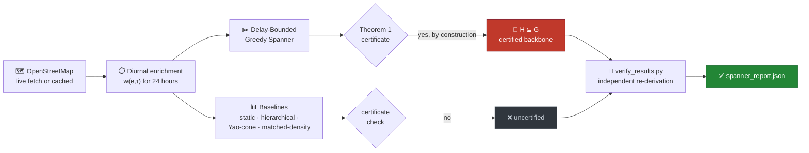

---

## 2. Algorithm — Delay-Bounded Greedy Spanner

$$
\begin{aligned}
&1.\ \ \text{order } E \text{ ascending by } \max_\tau w(e, \tau) \\
&2.\ \ H \leftarrow \varnothing \\
&3.\ \ \text{for } (u, v) \in E \text{ in that order:} \\
&4.\ \ \quad \text{for } \tau \text{ ordered by ascending } w((u,v), \tau):\quad \text{\small(tightest budget first)} \\
&5.\ \ \qquad \beta \leftarrow t \cdot w((u,v), \tau) \\
&6.\ \ \qquad \text{if } \mathrm{BoundedDijkstra}(H, u{\to}v, \tau, \beta) > \beta: \\
&7.\ \ \qquad\quad H \leftarrow H \cup \{(u,v)\};\ \text{break} \qquad \text{\small(early exit)} \\
&8.\ \ \text{return } H
\end{aligned}
$$

Complexity $O(|E| \cdot 24 \cdot |B| \log|B|)$, $|B|$ the size of the local metric ball. The empirical scaling exponent ($T \propto |E|^k$) is measured fresh on every run — see panel (e) of `results/spanner_benchmark.png`.

**This is the actual algorithm running**, not a mockup — the animation below replays the real `_edge_order()` and `bounded_dijkstra()` decisions (from `tools/make_algorithm_animation.py`) on a small toy grid chosen for legibility; it is illustrative/schematic, not a benchmark result, and feeds no number anywhere in this README:

<p align="center">
  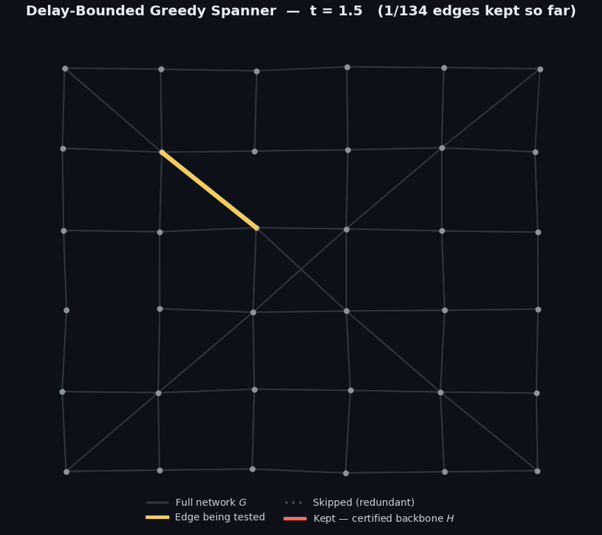
</p>

---

## 3. Baselines compared

| Method | What it is | Certified? |
|---|---|---|
| **Delay-Bounded Spanner (ours)** | Theorem-1 construction above | **Yes, by construction** |
| Static Free-Flow Spanner | Classical greedy spanner on the free-flow snapshot only | No |
| Mean-Temporal Spanner | Greedy spanner on the 24h-averaged cost | No |
| Static Geometric Spanner | Classical Euclidean-length greedy spanner | No |
| Yao-Cone Sparsifier (k=8) | Network-constrained adaptation of the classical Yao graph (cheapest edge per 45° cone per node) — *not* the unconstrained-point-set construction with the closed-form `1/(1-2 sin(π/k))` stretch bound; that bound does not apply here and is not claimed | No |
| Hierarchical Road Classifier | Keep only arterial/collector classes + last-mile attachment | No |
| Matched-Density Random / Betweenness | Density-matched structural controls (same edge budget as ours) | No |
| Full Network | Ground truth (`t = 1`) | — |

---

## 4. Results

Numbers in this section are **not** hand-copied into this README. (Sections 5b-5d quote values from `results/benchmarks/*.csv`; `tests/test_offgrid_and_readme.py` checks section 5d against its CSV.) They live in the auto-generated files below, regenerated fresh by every run of `run_spanner_benchmark.py`, so there is exactly one source of truth and it cannot silently drift out of sync with the code that produced it:

- [`results/benchmark_table.md`](results/benchmark_table.md) — focus-city (default: Yazd) sweep across `t`, all baselines, with 95% CI on mean dilation and the certificate's attained worst-case edge stretch
- [`results/ablation_table.md`](results/ablation_table.md) — edge-ordering ablation (`temporal_max` / `temporal_mean` / `centrality`)
- [`results/crosscity_table.md`](results/crosscity_table.md) — all cities, Iran + international, with data provenance (`OSM` vs `synthetic`), street-orientation entropy, circuity, and the advantage ratio over the matched-density control
- [`results/spanner_report.json`](results/spanner_report.json) — full machine-readable record: every table above plus the morphology regression, the pair-level and city-level significance tests, the FIFO time-dependent validation, and the congestion-model sensitivity sweep
- [`results/spanner_benchmark.png`](results/spanner_benchmark.png) — 7-panel focus-city figure
- [`results/spanner_crosscity.png`](results/spanner_crosscity.png) — 4-panel cross-city generalization figure
- [`results/per_pair_dilation.csv`](results/per_pair_dilation.csv) — raw per-OD-pair dilation at the focus city's peak hour (the raw data behind the significance tests — see §5)

Run `python run_spanner_benchmark.py` to (re)generate all of the above from scratch.

<p align="center">
  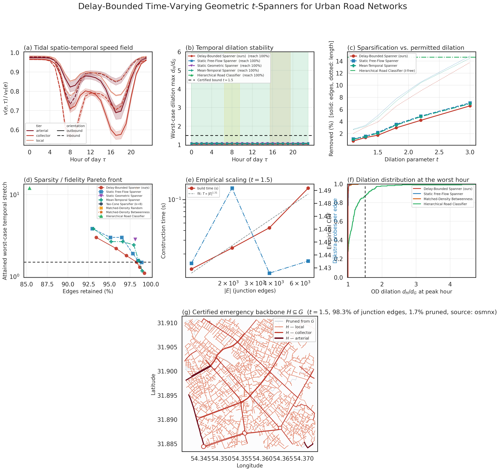
  <br><sub><b>Figure 1.</b> Focus city, real OpenStreetMap data — temporal dilation stability, sparsification vs. permitted dilation, sparsity/fidelity Pareto front, empirical scaling, dilation distribution at the worst hour, and the certified emergency backbone overlaid on the full network.</sub>
</p>

<p align="center">
  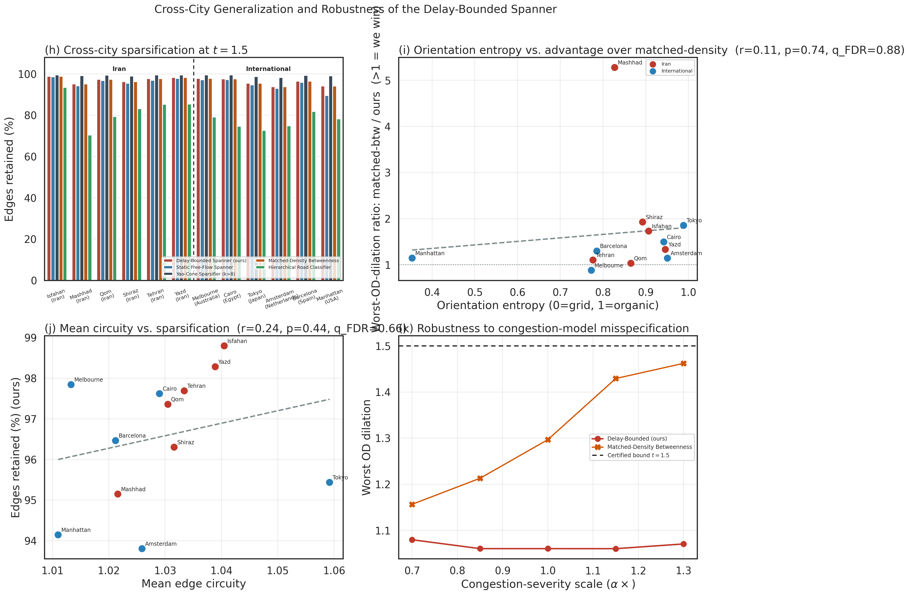
  <br><sub><b>Figure 2.</b> Cross-city generalization — sparsification across all 12 cities, street-morphology regressions, and robustness of the certified bound to congestion-model misspecification.</sub>
</p>

---

## 5. Verification & Reproducibility

This section documents how each result is checked and how to reproduce it.

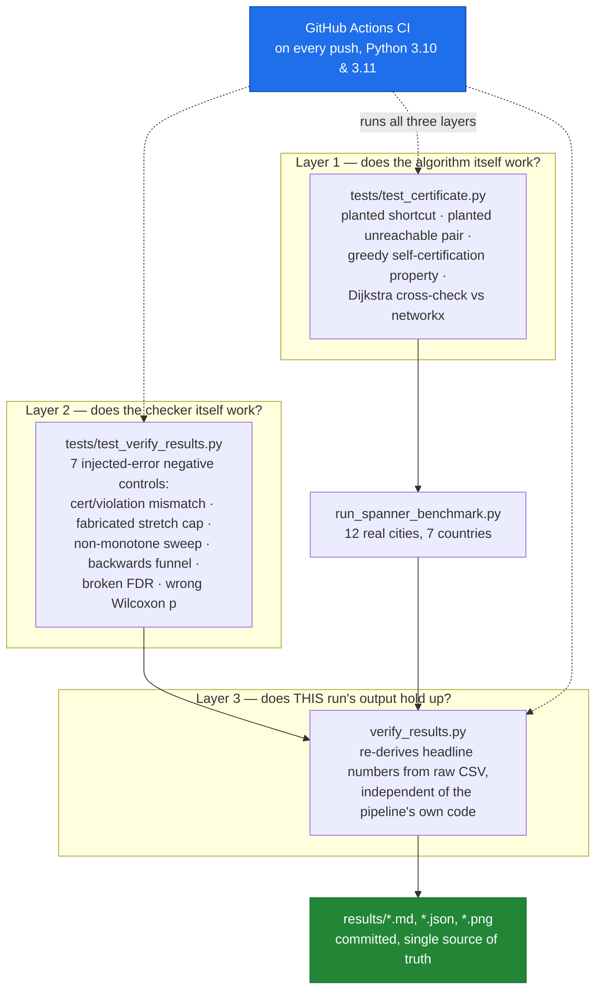

Concretely, this repo has:

**Unit tests** (`tests/test_certificate.py`, `python -m unittest discover -s tests -v`) — analytically-known positive and negative controls run against the *actual* production functions, not a reimplementation:
- a planted shortcut edge whose removal must break certification with an **exactly** computable attained stretch (`6.0`, hand-derived);
- a planted unreachable pair, which must be reported as `∞`, not a finite guess;
- a property test that the greedy construction always self-certifies against its own parent graph, across multiple random seeds and `t` values;
- an independent cross-check of the core `bounded_dijkstra` primitive against `networkx`'s own (separately implemented, widely trusted) shortest-path routine, on 20 random graphs.

**An independent verifier** (`verify_results.py`) — deliberately *not* part of the pipeline, imports none of its aggregation code, and re-derives headline numbers (worst/mean dilation, the Wilcoxon p-value) straight from the raw `per_pair_dilation.csv` using a separate pandas/scipy code path, then checks them against what the pipeline itself reported. Eight independent checks in total: certificate internal consistency, the anti-fabrication check for the bug below, re-derived dilation statistics, a re-derived Wilcoxon p-value, sparsification monotonicity in `t`, cross-city data provenance, a connectivity-funnel sanity check (an SCC/contraction filter can only remove nodes or edges, never add them), and a Benjamini-Hochberg FDR-correction sanity check (an adjusted p-value can never be smaller than its own raw p-value) on the multi-comparison morphology regression. Paths are CLI-overridable (`--results-dir`, `--report`, `--perpair`) specifically so it can be driven in isolation by tests, not only by eyeballing a terminal.

**The verifier is tested against itself** (`tests/test_verify_results.py`) — a minimal, fully synthetic report is built in-memory, and each test corrupts exactly one thing (a `certified: true` paired with nonzero violating edges, a fabricated repeated stretch cap, non-monotone sparsification, a connectivity funnel running backwards, a broken FDR correction, a reported Wilcoxon p-value that doesn't match what scipy actually computes from the raw data) and asserts `verify_results.py` catches that *specific* failure, with every other check still passing. Without this, "we have a verifier" is just as unverifiable a claim as anything it checks.

**Continuous integration** (`.github/workflows/ci.yml`) — on every push: byte-compile, all unit tests (certificate controls + the verifier's own negative controls), a full `--quick --synthetic` pipeline run, and `verify_results.py` against its output, on Python 3.10 and 3.11.

**Graph caching for cold reproducibility** (`results/graph_cache/`) — every fetched or synthesized road network is cached (pickle + a small, git-trackable `.meta.json` sidecar recording fetch time, source, node/edge counts). A later run reproduces the exact same graph offline; `--refresh-cache` forces a clean refetch.

### A documented correction

An earlier version of `temporal_stretch_certificate()` refined violating edges with a *bounded* search (`budget = 8× the edge's own cost`) and, on timeout, silently reported `attained_worst_edge_stretch = 8.0` for **every** such case — a fixed search-cutoff artifact, not a measured value, and it looked exactly like the kind of suspiciously round, repeated number that should be distrusted rather than reported at face value. It was caught by inspection, not by a test (the test that would have caught it, `TestUnreachableViolationIsReportedAsInfinity`, was written afterward specifically so it can't recur silently). The fix runs a genuinely unbounded search on refinement: violating edges get their true attained stretch, and truly unreachable pairs are now reported honestly as `∞ (n unreachable)` rather than a fabricated finite number. Tables now show `≥X` when the search was truncated before refining every violation (a disclosed lower bound, never a silent cap).

### What is *not* yet independently validated

- The diurnal congestion field is a **parametric** model (tidal, CBD-weighted, inbound/outbound-asymmetric), not fitted to floating-car or loop-detector telemetry. `results/spanner_report.json → congestion_sensitivity` quantifies robustness to this choice (±30% severity) but does not substitute for a telemetry-fitted replication.
- **Congestion model vs. measured traffic: shape compared on two sensor graphs only.** The parametric diurnal congestion model has **not** been compared against measured hourly traffic data for any of the twelve OSM cities (the NYC DOT shape comparison prepared in `tools/validate_congestion_shape.py` could not be run: the data endpoint was not reachable from the authors' network). Its hourly shape was compared with measured weekday-median speeds on the METR-LA and PEMS-BAY sensor graphs (section 5b, correlation values there); those are sensor graphs, not street networks, so this does not validate the congestion field on any of the twelve cities.
- Twelve cities across seven countries support a *directional* cross-morphology, cross-country generalization claim (`morphology_regression`, `city_level_significance`, `iran_vs_international_comparison` in the report) — not a definitive one. City-level tests are underpowered by design (n = cities, not OD pairs); they are reported with that caveat rather than presented as confirmatory.
- Cities whose live OSMnx/Overpass fetch is unavailable fall back to a deterministic, morphology-parameterized synthetic generator. Every city's `used_real_osm` flag states which was used for that specific run — check it before citing a number as coming from real map data.

---

## 5b. Benchmarks against the literature

All commands below are in `benchmarks/literature_benchmarks.py`; outputs go to `results/benchmarks/`. Protocols follow peer-reviewed experimental studies (see [`docs/LITERATURE_VERIFIED.md`](docs/LITERATURE_VERIFIED.md)).

<!-- BEGIN:literature -->
| Check | Protocol source | Result |
|---|---|---|
| Reduction to the classical path-greedy spanner (constant profile), edge-for-edge against an independent reference; Yao/Theta theoretical stretch bounds | Farshi & Gudmundsson (ESA 2005; WEA 2007); Althofer et al. (1993) | 48/48 instances identical; 0 bound violations |
| General graphs (ER, BA, random geometric) vs. Baswana-Sen (2k-1)-spanners | Baswana & Sen (2007); Chimani & Stutzenstein (arXiv:2107.02018) | stretch <= 2k-1 for all; greedy keeps 28-50% of edges vs. 81-100% for Baswana-Sen on these graphs (range of the per-setting means) |
| Exhaustive all-pairs, all-hours check of Theorem 1 on random time-varying digraphs, with negative controls | this work | 0 soundness violations on 236 instances |
| Certified baseline: union of per-hour static greedy spanners | this work | also certified; the delay-bounded construction keeps fewer edges on average (about 0.82x at t = 3 on random digraphs) but is not provably never larger: in 6 of 236 random instances (t <= 1.5) it kept 1-2 more edges |
| Measured speeds, METR-LA (207 sensors, Los Angeles) | Li et al. (ICLR 2018) | delay-bounded: certified at every t in {1.1,...,3.0}; static free-flow and mean-temporal: not certified (74-533 violating edges). Edges kept vs. union-of-snapshots: 54.5% vs. 55.9% (t = 1.1), 25.0% vs. 28.8% (t = 3.0) |
| Congestion-model shape vs. METR-LA | this work | Pearson r = 0.86 on normalised hourly mean speed; peak/off-peak slowdown 1.38x measured vs. 1.50x modelled |
| Measured speeds, PEMS-BAY (325 sensors, SF Bay Area) | Li et al. (ICLR 2018) | delay-bounded: certified at every t; static free-flow: not certified at any t (1-922 violating edges); mean-temporal: certified only at t = 2.0 (21.3% edges vs. 21.9% for delay-bounded). Edges kept vs. union-of-snapshots: 34.7% vs. 36.5% (t = 1.1), 21.7% vs. 24.7% (t = 3.0) |
| Congestion-model shape vs. PEMS-BAY | this work | Pearson r = 0.94; peak/off-peak slowdown 1.34x measured vs. 1.50x modelled |
<!-- END:literature -->

```bash
python benchmarks/literature_benchmarks.py static   --sizes 40 60 --reps 2 --t 1.25 1.5 2.0
python benchmarks/literature_benchmarks.py general  --sizes 100 200 --reps 3
python benchmarks/literature_benchmarks.py theorem1 --instances 60 --max-n 18
python benchmarks/literature_benchmarks.py metrla   --speeds METR-LA.csv                    # https://zenodo.org/records/5724362
python benchmarks/literature_benchmarks.py metrla   --speeds PEMS-BAY.csv --dataset pemsbay
python benchmarks/literature_benchmarks.py dimacs   --gr USA-road-d.NY.gr.gz
```

The METR-LA / PEMS-BAY graphs are sensor graphs (edge = driving distance between sensors) with measured hourly weekday-median speeds, not complete street networks.

---

## 5c. Why road networks barely sparsify: a forced-edge lower bound

For an edge e = (u, v), let r(e) be the largest over hours of d_{G-e}(u, v) / w(e), where G-e is the network without e. If r(e) > t, then e belongs to every edge-subset t-spanner of G at every stage of any construction, since a subgraph of G-e cannot offer a detour shorter than G-e does. The fraction of such edges is therefore a lower bound on edge retention for any algorithm (`benchmarks/retention_diagnostics.py`, `results/benchmarks/retention_diagnostics.md`).

<!-- BEGIN:retention -->
Mean over the 12 OSM city cores (about 1.5 km radius, degree-2 contracted):

| t | forced lower bound (%) | delay-bounded greedy retention (%) | share of retained edges that are forced |
|---|---|---|---|
| 1.1 | 98.5 | 98.5 | 1.000 |
| 1.5 | 96.2 | 96.6 | 0.996 |
| 2.0 | 91.9 | 93.8 | 0.980 |
| 3.0 | 83.9 | 89.6 | 0.934 |
| 5.0 | 73.2 | 86.5 | 0.843 |

Source: `results/benchmarks/retention_diagnostics.csv`.
<!-- END:retention -->

At t <= 1.5 the greedy retention equals the structural lower bound (to within 0.4 points); the small sparsification at small t is a property of road networks, not of the construction. For larger t the bound is not claimed to be tight, so a gap to the greedy retention (13 points at t = 5) leaves room for better constructions.

```bash
python benchmarks/retention_diagnostics.py --t 1.1 1.5 2 3 5
```

---

## 5d. Large-t behaviour and morphology

Forced-edge lower bound (Theorem 2, [`docs/THEOREM_FORCED_EDGES.md`](docs/THEOREM_FORCED_EDGES.md)) and delay-bounded greedy retention over a wide stretch grid; mean over the twelve OSM city cores (`benchmarks/retention_morphology.py`, `results/benchmarks/retention_large_t.csv`):

<!-- BEGIN:large_t -->
| t | forced lower bound (%) | greedy retention (%) | gap (points) |
|---|---|---|---|
| 1.5 | 96.2 | 96.6 | 0.4 |
| 2.0 | 91.9 | 93.8 | 1.9 |
| 3.0 | 83.9 | 89.6 | 5.7 |
| 5.0 | 73.2 | 86.5 | 13.3 |
| 7.0 | 65.6 | 84.9 | 19.3 |
| 10.0 | 58.2 | 83.8 | 25.6 |

- Retention stays above 81% for every city up to t = 3, and above 73% up to t = 10; retention falls to 90% or below at t = 2 (Mashhad) to t = 10 (Tehran); Isfahan stays above 95% through t = 10.
- Across the 12 cities, retention correlates strongly with the share of arcs that have no alternative directed path (bridge share; Spearman rho = 0.76-0.95 for t >= 2, BH-adjusted p <= 0.043). This is largely structural: such arcs are forced for every t, so the share is itself a lower bound on retention.
- None of the geometric morphology descriptors (orientation entropy, circuity, mean degree, edge-length CV) is significant after Benjamini-Hochberg correction over 84 tests (n = 12 cities); the study has low power and reports no morphology effect.
- The gap between greedy retention and the forced bound grows with t (25.6 points at t = 10). The bound is not claimed to be tight, so no optimality claim is made for the construction.
<!-- END:large_t -->

```bash
python benchmarks/retention_morphology.py
```

---

## 5e. Figures

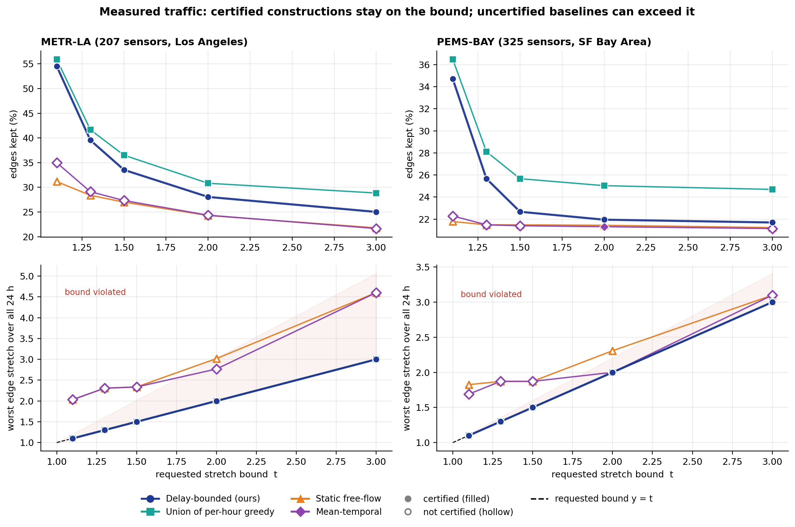
*Fig. 1. METR-LA and PEMS-BAY: edges kept and attained worst-edge stretch. Filled markers are certified; hollow markers violate the bound.*

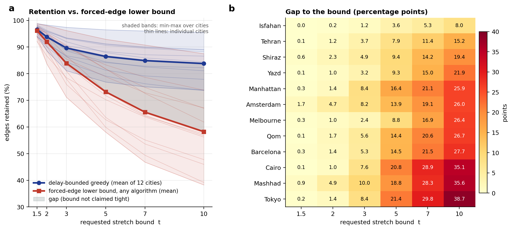
*Fig. 2. Theorem 2 lower bound vs. delay-bounded greedy retention (a) and the gap per city and t (b).*

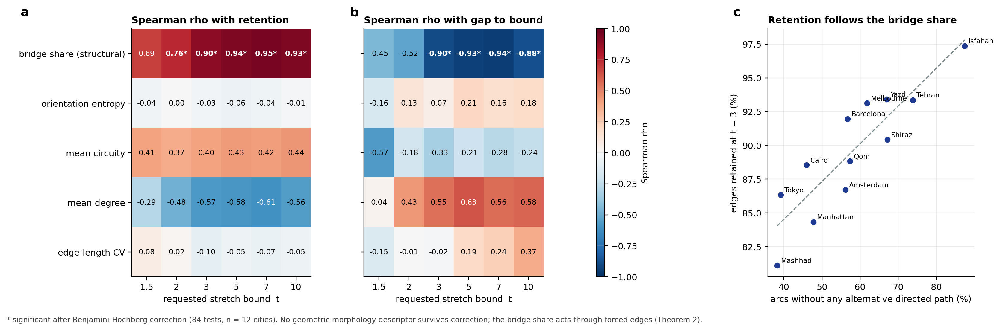
*Fig. 3. Spearman matrices with Benjamini-Hochberg-corrected significance, and retention vs. bridge share.*

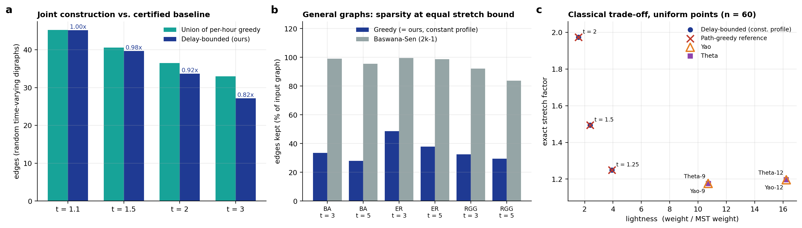
*Fig. 4. Joint construction vs. union of per-hour greedy spanners (a), general graphs vs. Baswana-Sen (b), classical lightness-stretch trade-off (c).*

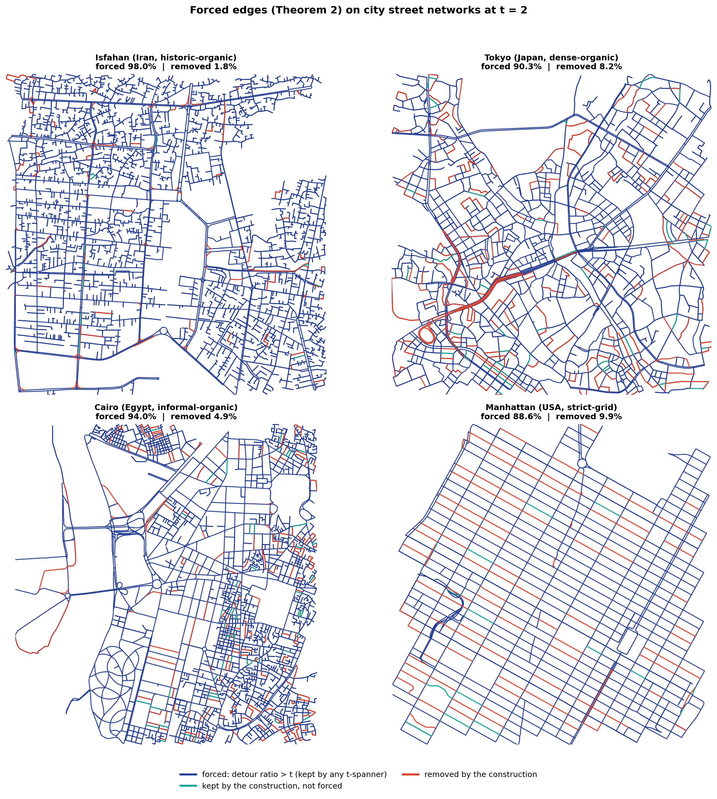
*Fig. 5. Forced edges (Theorem 2, blue), edges kept although not forced (green) and edges removed (red) at t = 2 on four OSM city cores.*

Vector (PDF) versions of all figures are in `results/figures/`. Regenerate with `python benchmarks/make_figures.py`.

---

## 5f. Continuous-time guarantee (off-grid robustness)

Theorem 1 certifies the 24 grid hours. `benchmarks/offgrid_guarantee.py` implements two provable continuous-time constructions (Theorems 3 and 3b, derivations in the script docstring) based on the piecewise-linear profile `td_cost`. Theorem 3b uses a per-edge interpolation factor rho_e and certifies every time of day. Edges kept (%), measured speeds, sub-grid of 7.5 min:

| Dataset | T | grid-only (Thm 1) | continuous-time (Thm 3b) | edges kept only because rho_e^2 >= T (%) | off-grid violations in sampled checks |
|---|---|---|---|---|---|
| METR-LA | 1.5 | 33.5 | 44.1 | 4.03 | 0 |
| METR-LA | 2.0 | 28.1 | 30.8 | 0.00 | 0 |
| METR-LA | 3.0 | 25.0 | 24.3 | 0.00 | 0 |
| PEMS-BAY | 1.5 | 22.7 | 27.0 | 1.22 | 0 |
| PEMS-BAY | 2.0 | 22.0 | 22.3 | 0.00 | 0 |
| PEMS-BAY | 3.0 | 21.7 | 21.4 | 0.00 | 0 |

The single global factor of Theorem 3 is feasible only at T = 3 on both datasets (rho = 1.176 / 1.173 even on a 3.75-minute sub-grid); the per-edge version removes that restriction. The sampled off-grid checks are empirical sanity checks; the guarantee is the theorem. Raw results: `results/benchmarks/offgrid_guarantee_metrla.csv`, `offgrid_guarantee_pemsbay.csv`.

```bash
python benchmarks/offgrid_guarantee.py --dataset metrla  --speeds METR-LA.csv  --T 1.5 2.0 3.0
python benchmarks/offgrid_guarantee.py --dataset pemsbay --speeds PEMS-BAY.csv --T 1.5 2.0 3.0
```

---

## 5g. Larger radius (3.5 km)

Generated by `scripts/update_readme_from_results.py` from `results/benchmarks/large_scale_3500m.csv` (`python benchmarks/large_scale_run.py --dist 3500`). Real OpenStreetMap networks only; the delay-bounded spanner is certified in every row.

| City | Nodes | Edges | t | Delay-bounded kept (%) | Forced lower bound (%) | Static free-flow kept (%) | Static free-flow certified | Union of per-hour greedy kept (%) |
|---|---|---|---|---|---|---|---|---|
| Isfahan | 27646 | 57209 | 1.5 | 98.7 | 98.7 | 98.5 | no |  |
| Isfahan | 27646 | 57209 | 2 | 97.8 | 97.4 | 97.6 | no | 97.9 |
| Isfahan | 27646 | 57209 | 3 | 96.1 | 94.5 | 95.9 | no |  |
| Tokyo | 7596 | 18938 | 1.5 | 95.9 | 95.7 | 95.0 | no |  |
| Tokyo | 7596 | 18938 | 2 | 92.0 | 90.2 | 90.6 | no | 92.6 |
| Tokyo | 7596 | 18938 | 3 | 85.0 | 75.9 | 83.8 | no |  |
| Manhattan | 2637 | 5583 | 1.5 | 96.8 | 96.6 | 94.0 | no |  |
| Manhattan | 2637 | 5583 | 2 | 92.6 | 89.8 | 89.2 | no | 93.9 |
| Manhattan | 2637 | 5583 | 3 | 86.5 | 77.5 | 83.8 | no |  |

---

## 5h. Congestion model vs measured street speeds (Manhattan)

Generated by `scripts/nyc_figure_and_section.py` from `results/congestion_shape_validation_Manhattan.json` and the NYC DOT traffic-speed feed (dataset `i4gi-tjb9`, 2026-09-01 to 2026-10-01, weekdays only).

| Borough | Weekdays | Pearson r (95% CI) | Spearman rho | Peak/off-peak slowdown, measured | Peak/off-peak slowdown, model | Slowest / fastest hour (measured) |
|---|---|---|---|---|---|---|
| Manhattan | 20 | 0.69 (0.61 to 0.74) | 0.76 | 2.07x | 1.50x | 17:00 / 5:00 |

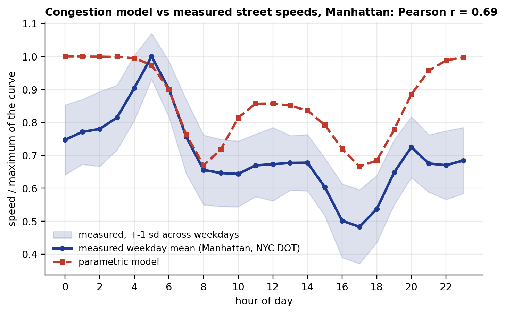

The agreement is moderate, clearly lower than on the two freeway sensor networks (section 5b). One borough and one month are covered; this is a shape comparison, not a calibration of congestion severity.

---

## 5i. Sensitivity to congestion severity

Generated by `scripts/render_severity_section.py` from `results/benchmarks/severity_sensitivity.csv` (`python benchmarks/severity_sensitivity.py`; cities: Cairo, Isfahan, Manhattan, Tokyo). The excess delay of every edge is rescaled, tt_k(h) = tt_ff (1 + k (tt(h)/tt_ff - 1)); k = 1 is the original model. Measured peak/off-peak slowdowns are 1.34-1.38x on freeways and 2.07x on Manhattan streets against 1.50x for the model's representative edge; k = 2.14 reproduces the Manhattan slowdown for that edge.

| Severity factor k | Mean per-edge max/min travel-time ratio | t | Delay-bounded kept (%) | Forced lower bound (%) | Static free-flow kept (%) | Static free-flow uncertified (cities) | Mean violating edges, static free-flow | Delay-bounded certified in all cities |
|---|---|---|---|---|---|---|---|---|
| 0.5 | 1.20 | 1.5 | 96.0 | 95.8 | 95.0 | 4 of 4 | 17 | yes |
| 0.5 | 1.20 | 2 | 93.1 | 92.0 | 92.1 | 4 of 4 | 23 | yes |
| 1 | 1.39 | 1.5 | 96.5 | 96.3 | 95.0 | 4 of 4 | 29 | yes |
| 1 | 1.39 | 2 | 93.8 | 92.8 | 92.1 | 4 of 4 | 37 | yes |
| 1.5 | 1.59 | 1.5 | 96.9 | 96.8 | 95.0 | 4 of 4 | 38 | yes |
| 1.5 | 1.59 | 2 | 94.2 | 93.3 | 92.1 | 4 of 4 | 48 | yes |
| 2.14 | 1.84 | 1.5 | 97.1 | 97.0 | 95.0 | 4 of 4 | 44 | yes |
| 2.14 | 1.84 | 2 | 94.6 | 93.7 | 92.1 | 4 of 4 | 58 | yes |

Means are over the listed cities. The static free-flow baseline does not depend on k (it ignores congestion), so its retention is constant while its violations are measured against the rescaled profile.

---

## 6. Reproduce

```bash
conda create -n spanner_research_env python=3.10 -y
conda activate spanner_research_env
conda install -c conda-forge networkx osmnx geopandas shapely scipy numpy pandas matplotlib seaborn tqdm -y

python -m unittest discover -s tests -v           # unit tests
python run_spanner_benchmark.py                    # full run: focus city + 12-city cross-city study
python verify_results.py                           # independent check of what was just produced

python run_spanner_benchmark.py --quick             # fast smoke test (stratified Iran + international)
python run_spanner_benchmark.py --synthetic         # force offline mode everywhere
python run_spanner_benchmark.py --skip-crosscity    # focus city only
python run_spanner_benchmark.py --refresh-cache      # ignore the graph cache and refetch/rebuild
```

If Overpass/OSMnx is unreachable, the pipeline transparently falls back to the deterministic synthetic generator and labels each city's `used_real_osm` flag accordingly — it never silently mixes real and synthetic data without saying so.

---

## 7. Repository layout

```
.
├── run_spanner_benchmark.py       # single self-contained pipeline (model, algorithm, baselines, eval, figures)
├── verify_results.py              # independent verification, separate code path from the pipeline
├── tests/
│   ├── test_certificate.py        # unit tests: positive/negative controls + independent Dijkstra cross-check
│   ├── test_verify_results.py     # negative controls proving the verifier itself catches injected errors
│   └── test_congestion_shape.py   # unit tests + negative controls for the congestion-shape validator
├── tools/
│   ├── make_algorithm_animation.py  # regenerates assets/algorithm_demo.gif from the real algorithm
│   └── validate_congestion_shape.py # shape-only check of the congestion model vs measured NYC DOT speeds (not yet run: data unreachable)
├── assets/
│   └── algorithm_demo.gif         # illustrative only — not a benchmark result, feeds no number in this README
├── .github/workflows/ci.yml       # unit tests + smoke run + verification, on every push
├── requirements.txt
├── LICENSE
├── CITATION.cff
├── README.md
└── results/
    ├── spanner_benchmark.png
    ├── spanner_crosscity.png
    ├── spanner_report.json
    ├── benchmark_table.md
    ├── ablation_table.md
    ├── crosscity_table.md
    ├── per_pair_dilation.csv
    └── graph_cache/               # .meta.json tracked; .pkl gitignored (see .gitignore)
```

---

## 8. Known limitations

- The certificate (Theorem 1) holds at the 24 grid hours only. With the piecewise-linear interpolation used by `td_cost`, off-grid times and time-dependent traversal can exceed `t` slightly (observed: at most about 0.5% above `t` in random-instance tests, `benchmarks/offgrid_guarantee.py`). Theorem 3 gives a provable continuous-time bound `t` by certifying on a finer grid at `t / rho^2`, at the price of more retained edges.
- Evaluation scale: the twelve-city table uses city cores of about 1.5 km radius with 30 x 30 OD pairs and 5 repeats per city; larger-radius runs on three cities are reported in section 5g.
- Snapshot (time-slice) model: no departure-time evolution *within* a single traversal; ex-post validated by a FIFO time-dependent Dijkstra experiment (`fifo_violation_rate` in `results/spanner_report.json`).
- Congestion is a parametric model, not measured telemetry — see §5.
- Greedy construction carries no approximation guarantee on `|H|`; the matched-density and Yao-cone baselines are empirical, not theoretical, lower-bound proxies.
- Twelve cities is enough for a directional generalization claim, not a definitive one — see §5.
- Sparsification on road networks is modest (roughly 93-99% of edges retained at t = 1.5 on the OSM cities): most road edges have no short alternative path, so an edge-wise t-spanner cannot remove them.
- On OD-pair dilation (12 cities; 30 sources x 30 targets x 5 repeats per city) the matched-density betweenness control has a larger worst-OD dilation than the construction in 11 of 12 cities (advantage ratio above 1); the ratio is below 1 in Melbourne (0.88); the city-level test in the report gives p = 0.001221 (`results/crosscity_table.md`). The guarantee is the certificate; this comparison is secondary and depends on the choice of the matched control.
- The union of per-hour static greedy spanners is also certified; the advantage of the joint construction over it is small (see §5b).

---

## 9. Related Work

**Classical spanners.** The greedy construction and its size bounds are due to Althöfer, Das, Dobkin, Joseph and Soares [6]; Peleg and Schäffer [7] studied graph spanners in general; the geometric theory is surveyed in the monograph of Narasimhan and Smid [8]; and Yao graphs [9] are the cone-based sparsifier that one of our baselines adapts to road networks. These works treat static edge weights.

**Fault-tolerant geometric spanners.** Abam, de Berg, Farshi and Gudmundsson study spanners that keep their stretch guarantee after all vertices inside a geometric region fail, and they also treat a geodesic variant in which the faulty set is a disk [1]. Our setting differs: no vertices fail, but edge costs change with the hour of day. The two share the idea that one sparse subgraph must certify a stretch bound under a family of scenarios (failure regions there, hours τ ∈ {0..23} here). The first algorithms for geometric fault-tolerant spanners are due to Levcopoulos, Narasimhan and Smid [10].

**Experimental evaluation of spanner algorithms.** Farshi and Gudmundsson compare geometric t-spanner constructions empirically, in terms of quality and running time [2, 3]. We follow this empirical tradition, but on real road networks with time-dependent travel cost rather than Euclidean point sets.

**Improving stretch by augmentation.** Farshi, Giannopoulos and Gudmundsson study how adding edges to a geometric network reduces its stretch factor [4]; our certificate is a sparsification-side counterpart, deciding which edges can be dropped without breaking the bound.

**Weighted point sets.** Abam et al. construct spanners for point sets with weights [5], whereas we place the weights on the edges and let them vary over time.

**Time-dependent routing.** Cooke and Halsey [11] and Orda and Rom [12] established shortest-path computation when edge costs depend on time, including the FIFO property that we check empirically (`fifo_violation_rate`). Geisberger et al. [13] give contraction hierarchies, a leading speed-up for static road graphs; hierarchical road classes appear here only as a baseline.

**Data.** Road networks are obtained with OSMnx [14] from OpenStreetMap.

**References**

1. M. A. Abam, M. de Berg, M. Farshi, J. Gudmundsson. Region-fault tolerant geometric spanners. *Discrete & Computational Geometry* 41(4):556–582, 2009. doi:10.1007/s00454-009-9137-7
2. M. Farshi, J. Gudmundsson. Experimental study of geometric t-spanners. *ACM Journal of Experimental Algorithmics* 14, Article 1.3, 2010 (conference version: ESA 2005, pp. 556–567).
3. M. Farshi, J. Gudmundsson. Experimental study of geometric t-spanners: a running time comparison. WEA 2007, pp. 270–284.
4. M. Farshi, P. Giannopoulos, J. Gudmundsson. Improving the stretch factor of a geometric network by edge augmentation. *SIAM Journal on Computing* 38(1):226–240, 2008.
5. M. A. Abam, M. de Berg, M. Farshi, J. Gudmundsson, M. Smid. Geometric spanners for weighted point sets. *Algorithmica* 61(1):207–225, 2011.
6. I. Althöfer, G. Das, D. Dobkin, D. Joseph, J. Soares. On sparse spanners of weighted graphs. *Discrete & Computational Geometry* 9(1):81–100, 1993. doi:10.1007/BF02189308
7. D. Peleg, A. A. Schäffer. Graph spanners. *Journal of Graph Theory* 13(1):99–116, 1989. doi:10.1002/jgt.3190130114
8. G. Narasimhan, M. Smid. *Geometric Spanner Networks*. Cambridge University Press, 2007.
9. A. C.-C. Yao. On constructing minimum spanning trees in k-dimensional spaces and related problems. *SIAM Journal on Computing* 11(4):721–736, 1982. doi:10.1137/0211059
10. C. Levcopoulos, G. Narasimhan, M. Smid. Efficient algorithms for constructing fault-tolerant geometric spanners. *Proc. 30th ACM Symposium on Theory of Computing (STOC)*, pp. 186–195, 1998. doi:10.1145/276698.276734
11. K. L. Cooke, E. Halsey. The shortest route through a network with time-dependent internodal transit times. *Journal of Mathematical Analysis and Applications* 14(3):493–498, 1966. doi:10.1016/0022-247X(66)90009-6
12. A. Orda, R. Rom. Shortest-path and minimum-delay algorithms in networks with time-dependent edge-length. *Journal of the ACM* 37(3):607–625, 1990. doi:10.1145/79147.214078
13. R. Geisberger, P. Sanders, D. Schultes, C. Vetter. Exact routing in large road networks using contraction hierarchies. *Transportation Science* 46(3):388–404, 2012. doi:10.1287/trsc.1110.0401
14. G. Boeing. OSMnx: New methods for acquiring, constructing, analyzing, and visualizing complex street networks. *Computers, Environment and Urban Systems* 65:126–139, 2017. doi:10.1016/j.compenvurbsys.2017.05.004

## Data and attribution

Street-network data: (c) OpenStreetMap contributors, available under the Open Database Licence (ODbL, https://www.openstreetmap.org/copyright). Derived graphs cached in `results/graph_cache/` are derivative databases under the same licence. Traffic speeds: METR-LA and PEMS-BAY as distributed by Li et al. (ICLR 2018; https://zenodo.org/records/5724362), sensor graphs from `liyaguang/DCRNN`. The graph snapshots behind the reported numbers should be archived with a DOI (e.g. Zenodo) at submission time.

---

## 10. Citation

See [`CITATION.cff`](CITATION.cff), or:

```bibtex
@software{delay_bounded_spanner_2026,
  title  = {Delay-Bounded Time-Varying Geometric t-Spanners for Urban Road Networks},
  author = {Soheil},
  year   = {2026},
  license = {MIT},
  note   = {Certified temporal sparsification, validated on real OpenStreetMap road networks across six Iranian and six international cities}
}
```
