# Delay-Bounded Time-Varying Geometric *t*-Spanners for Urban Road Networks

<p align="center">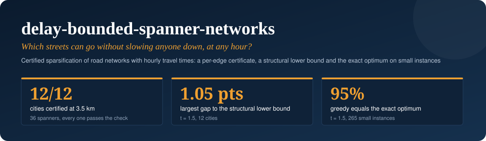</p>

**A certified sparsification framework that extracts a single physical road backbone, guaranteed to preserve bounded travel-time dilation at every hour of the day — validated end-to-end on real OpenStreetMap city cores (about 1.5 km radius) pulled live from OpenStreetMap, across six Iranian and six international cities (seven countries) spanning seven street-network morphology archetypes.**

[](https://github.com/soheylfalahzade/delay-bounded-spanner-networks/actions/workflows/ci.yml)
[](LICENSE)
[](requirements.txt)
[](https://www.openstreetmap.org)
[](results/crosscity_table.md)
[](#1-problem)

<p align="center">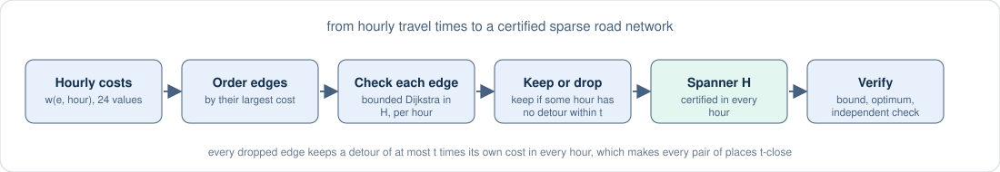</p>

<p align="center">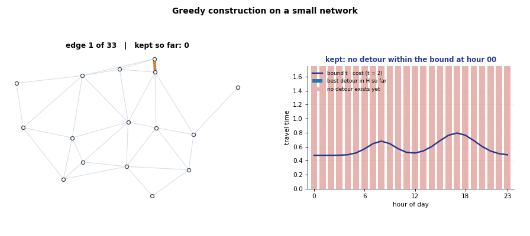</p>

<sub>Animation: the greedy construction on a small synthetic network. For each street segment (orange) the best detour in the spanner built so far is compared with the bound in every hour; the segment is kept as soon as one hour has no detour within the bound. Regenerate with `python benchmarks/make_visuals.py`.</sub>

## Research Program

This repository is one component of a connected research program on emergency-aware urban network control. The four repositories share a problem family, not code: each is self-contained and makes claims only within its own tested scope.

| Repository | Setting | Role in the program | Type of guarantee |
| --- | --- | --- | --- |
| [`geometric-spanners-lab`](https://github.com/soheylfalahzade/geometric-spanners-lab) | Euclidean point sets, undirected | Classical greedy t-spanner baseline | Exact by construction; independently re-derived by `verify_independent.py` |
| [`Research_Geometric_ML_Optimization`](https://github.com/soheylfalahzade/Research_Geometric_ML_Optimization) | Directed OpenStreetMap road graphs | Same spanner problem, with learned (GNN + fuzzy) edge pruning for speed | Per-edge local repair guarantee; global stretch validated empirically by Monte Carlo sampling (small nonzero violation rate in one city, disclosed in that repository's Limitations) |
| **[`delay-bounded-spanner-networks`](https://github.com/soheylfalahzade/delay-bounded-spanner-networks) (this repository)** | Directed road graphs with hourly speed profiles | Same problem under a time-varying delay constraint | Certified: an edge-wise certificate implies the all-pairs, all-hours bound (Theorem 1); congestion model is parametric; its hourly shape agrees with measured freeway telemetry (METR-LA r = 0.86, PEMS-BAY r = 0.94, section 5b) but is not validated on urban street speeds (its hourly shape was compared with measured speeds on two sensor graphs only) |
| [`anti-gridlock-signal-control`](https://github.com/soheylfalahzade/anti-gridlock-signal-control) | Signalized intersection and a three-junction corridor (SUMO) | Local control layer beneath a future network layer | Empirical (10 paired seeds per evaluation); no closed-loop stability proof |

Integration of the local control layer with the network layer is planned and has not been demonstrated. Open items per repository: the OpenStreetMap experiments in the lab repository use node coordinates only; the learned-pruning repository does not transfer to Tokyo scale (0.09% of edges pruned); the delay-bounded repository uses a parametric congestion field, compared with measured speeds only on two sensor graphs; the signal-control repository tests hand-set membership functions on at most three junctions.

## 1. Problem

<p align="center">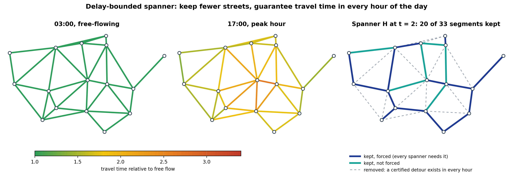</p>

<sub>Illustration on a small synthetic network, computed with this repository's construction at t = 2.</sub>

Let $G = (V, E)$ be a directed geometric road network. Each edge $e$ carries a length $\ell(e)$ and an hourly diurnal speed profile $v(e, \tau)$ for $\tau \in \{0, \dots, 23\}$, giving the time-sliced travel-time cost

$$w(e, \tau) \;=\; \frac{\ell(e)}{v(e, \tau)}$$

We construct a sparse backbone $H \subseteq E$ certified to satisfy

$$\forall\, u, v \in V,\ \ \forall\, \tau \in \{0,\dots,23\}:\qquad \mathrm{dist}_H(u, v, \tau) \;\le\; t \cdot \mathrm{dist}_G(u, v, \tau)$$

> **Theorem 1** *(edge-wise certificate ⇒ all-pairs, all-hours guarantee).*
> If $\mathrm{dist}_H(u,v,\tau) \le t \cdot w((u,v),\tau)$ holds for every edge $(u,v) \in E$ and every hour $\tau$, then $H$ is a delay-bounded time-varying $t$-spanner of $G$.
>
> *Proof.* Fix $\tau$; $w(\cdot,\tau)$ is a static, non-negative weighting, so concatenating the edge-wise invariant along a $\tau$-optimal path and applying the triangle inequality in $H_\tau$ gives the all-pairs bound, independently for every $\tau$. $\blacksquare$

*Status.* This is the standard edge-wise argument for graph spanners (compare Althöfer et al. [6]); it is stated here because it holds hour by hour on directed graphs, which makes the certificate exact and cheap to check. It is not presented as a new theorem. Theorem 2 (section 5c) is equally elementary: the same detour test underlies the fact that, for undirected graphs, a greedy spanner has no proper t-spanner of itself [15] (the argument does not carry over to directed graphs, see section 5n). What this repository adds is the measurement of the forced share on real road networks, by hour (section 5m) and under region faults (section 5l).

This collapses $|V|^2 \cdot 24$ pairwise constraints into $|E| \cdot 24$ *local* certificates, each decidable by a Dijkstra search pruned to the ball of radius $t \cdot w(e,\tau)$ — the diagram below shows the full pipeline this enables, and the animation under §2 shows the certificate decision actually running.

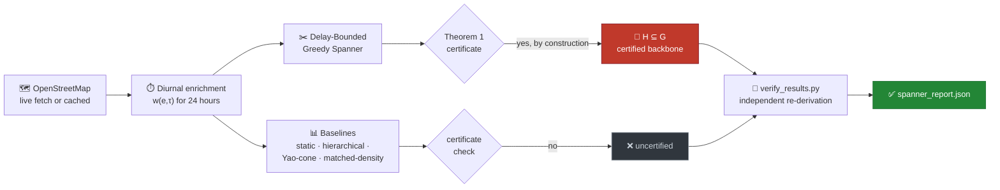

---

## 2. Algorithm — Delay-Bounded Greedy Spanner

$$
\begin{aligned}
&1.\ \ \text{order } E \text{ ascending by } \max_\tau w(e, \tau) \\
&2.\ \ H \leftarrow \varnothing \\
&3.\ \ \text{for } (u, v) \in E \text{ in that order:} \\
&4.\ \ \quad \text{for } \tau \text{ ordered by ascending } w((u,v), \tau):\quad \text{\small(tightest budget first)} \\
&5.\ \ \qquad \beta \leftarrow t \cdot w((u,v), \tau) \\
&6.\ \ \qquad \text{if } \mathrm{BoundedDijkstra}(H, u{\to}v, \tau, \beta) > \beta: \\
&7.\ \ \qquad\quad H \leftarrow H \cup \{(u,v)\};\ \text{break} \qquad \text{\small(early exit)} \\
&8.\ \ \text{return } H
\end{aligned}
$$

Complexity $O(|E| \cdot 24 \cdot |B| \log|B|)$, $|B|$ the size of the local metric ball. The empirical scaling exponent ($T \propto |E|^k$) is measured fresh on every run — see panel (e) of `results/spanner_benchmark.png`.

**This is the actual algorithm running**, not a mockup — the animation below replays the real `_edge_order()` and `bounded_dijkstra()` decisions (from `tools/make_algorithm_animation.py`) on a small toy grid chosen for legibility; it is illustrative/schematic, not a benchmark result, and feeds no number anywhere in this README:

<p align="center">
  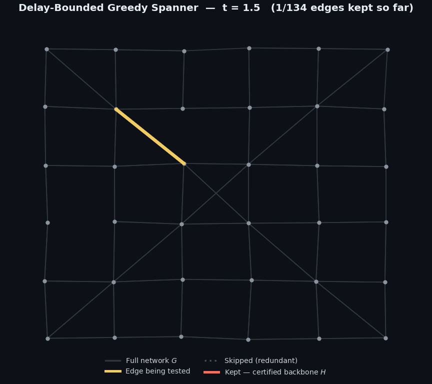
</p>

---

## 3. Baselines compared

| Method | What it is | Certified? |
|---|---|---|
| **Delay-Bounded Spanner (ours)** | Theorem-1 construction above | **Yes, by construction** |
| Static Free-Flow Spanner | Classical greedy spanner on the free-flow snapshot only | No |
| Mean-Temporal Spanner | Greedy spanner on the 24h-averaged cost | No |
| Static Geometric Spanner | Classical Euclidean-length greedy spanner | No |
| Yao-Cone Sparsifier (k=8) | Network-constrained adaptation of the classical Yao graph (cheapest edge per 45° cone per node) — *not* the unconstrained-point-set construction with the closed-form `1/(1-2 sin(π/k))` stretch bound; that bound does not apply here and is not claimed | No |
| Hierarchical Road Classifier | Keep only arterial/collector classes + last-mile attachment | No |
| Matched-Density Random / Betweenness | Density-matched structural controls (same edge budget as ours) | No |
| Full Network | Ground truth (`t = 1`) | — |

---

## 4. Results

Numbers in this section are **not** hand-copied into this README. (Sections 5b-5d quote values from `results/benchmarks/*.csv`; `tests/test_offgrid_and_readme.py` checks section 5d against its CSV.) They live in the auto-generated files below, regenerated fresh by every run of `run_spanner_benchmark.py`, so there is exactly one source of truth and it cannot silently drift out of sync with the code that produced it:

- [`results/benchmark_table.md`](results/benchmark_table.md) — focus-city (default: Yazd) sweep across `t`, all baselines, with 95% CI on mean dilation and the certificate's attained worst-case edge stretch
- [`results/ablation_table.md`](results/ablation_table.md) — edge-ordering ablation (`temporal_max` / `temporal_mean` / `centrality`)
- [`results/crosscity_table.md`](results/crosscity_table.md) — all cities, Iran + international, with data provenance (`OSM` vs `synthetic`), street-orientation entropy, circuity, and the advantage ratio over the matched-density control
- [`results/spanner_report.json`](results/spanner_report.json) — full machine-readable record: every table above plus the morphology regression, the pair-level and city-level significance tests, the FIFO time-dependent validation, and the congestion-model sensitivity sweep
- [`results/spanner_benchmark.png`](results/spanner_benchmark.png) — 7-panel focus-city figure
- [`results/spanner_crosscity.png`](results/spanner_crosscity.png) — 4-panel cross-city generalization figure
- [`results/per_pair_dilation.csv`](results/per_pair_dilation.csv) — raw per-OD-pair dilation at the focus city's peak hour (the raw data behind the significance tests — see §5)

Run `python run_spanner_benchmark.py` to (re)generate all of the above from scratch.

<p align="center">
  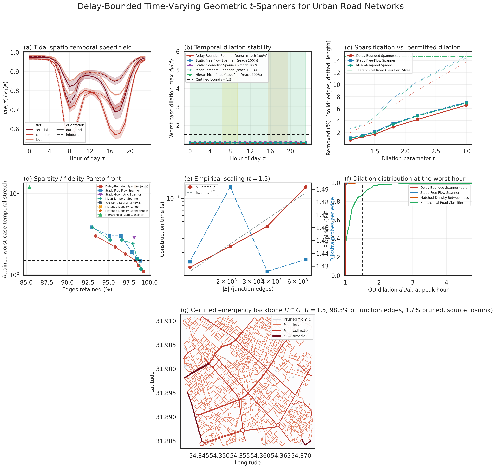
  <br><sub><b>Figure 1.</b> Focus city, real OpenStreetMap data — temporal dilation stability, sparsification vs. permitted dilation, sparsity/fidelity Pareto front, empirical scaling, dilation distribution at the worst hour, and the certified emergency backbone overlaid on the full network.</sub>
</p>

<p align="center">
  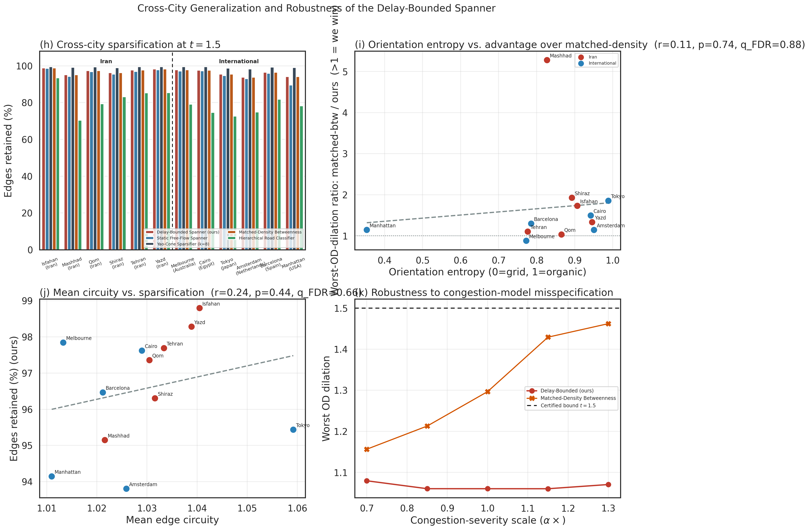
  <br><sub><b>Figure 2.</b> Cross-city generalization — sparsification across all 12 cities, street-morphology regressions, and robustness of the certified bound to congestion-model misspecification.</sub>
</p>

---

## 5. Verification & Reproducibility

This section documents how each result is checked and how to reproduce it.

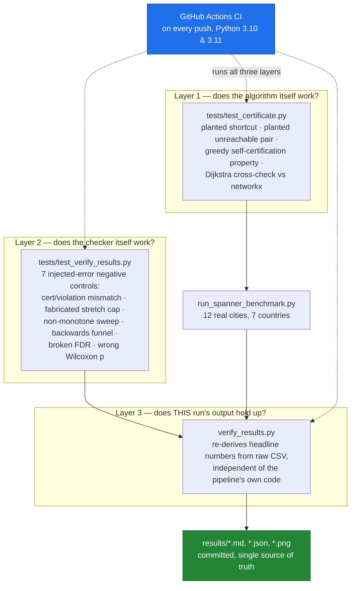

Concretely, this repo has:

**Unit tests** (`tests/test_certificate.py`, `python -m unittest discover -s tests -v`) — analytically-known positive and negative controls run against the *actual* production functions, not a reimplementation:
- a planted shortcut edge whose removal must break certification with an **exactly** computable attained stretch (`6.0`, hand-derived);
- a planted unreachable pair, which must be reported as `∞`, not a finite guess;
- a property test that the greedy construction always self-certifies against its own parent graph, across multiple random seeds and `t` values;
- an independent cross-check of the core `bounded_dijkstra` primitive against `networkx`'s own (separately implemented, widely trusted) shortest-path routine, on 20 random graphs.

**An independent verifier** (`verify_results.py`) — deliberately *not* part of the pipeline, imports none of its aggregation code, and re-derives headline numbers (worst/mean dilation, the Wilcoxon p-value) straight from the raw `per_pair_dilation.csv` using a separate pandas/scipy code path, then checks them against what the pipeline itself reported. Eight independent checks in total: certificate internal consistency, the anti-fabrication check for the bug below, re-derived dilation statistics, a re-derived Wilcoxon p-value, sparsification monotonicity in `t`, cross-city data provenance, a connectivity-funnel sanity check (an SCC/contraction filter can only remove nodes or edges, never add them), and a Benjamini-Hochberg FDR-correction sanity check (an adjusted p-value can never be smaller than its own raw p-value) on the multi-comparison morphology regression. Paths are CLI-overridable (`--results-dir`, `--report`, `--perpair`) specifically so it can be driven in isolation by tests, not only by eyeballing a terminal.

**The verifier is tested against itself** (`tests/test_verify_results.py`) — a minimal, fully synthetic report is built in-memory, and each test corrupts exactly one thing (a `certified: true` paired with nonzero violating edges, a fabricated repeated stretch cap, non-monotone sparsification, a connectivity funnel running backwards, a broken FDR correction, a reported Wilcoxon p-value that doesn't match what scipy actually computes from the raw data) and asserts `verify_results.py` catches that *specific* failure, with every other check still passing. Without this, "we have a verifier" is just as unverifiable a claim as anything it checks.

**Continuous integration** (`.github/workflows/ci.yml`) — on every push: byte-compile, all unit tests (certificate controls + the verifier's own negative controls), a full `--quick --synthetic` pipeline run, and `verify_results.py` against its output, on Python 3.10 and 3.11.

**Graph caching for cold reproducibility** (`results/graph_cache/`) — every fetched or synthesized road network is cached (pickle + a small, git-trackable `.meta.json` sidecar recording fetch time, source, node/edge counts). A later run reproduces the exact same graph offline; `--refresh-cache` forces a clean refetch.

### A documented correction

An earlier version of `temporal_stretch_certificate()` refined violating edges with a *bounded* search (`budget = 8× the edge's own cost`) and, on timeout, silently reported `attained_worst_edge_stretch = 8.0` for **every** such case — a fixed search-cutoff artifact, not a measured value, and it looked exactly like the kind of suspiciously round, repeated number that should be distrusted rather than reported at face value. It was caught by inspection, not by a test (the test that would have caught it, `TestUnreachableViolationIsReportedAsInfinity`, was written afterward specifically so it can't recur silently). The fix runs a genuinely unbounded search on refinement: violating edges get their true attained stretch, and truly unreachable pairs are now reported honestly as `∞ (n unreachable)` rather than a fabricated finite number. Tables now show `≥X` when the search was truncated before refining every violation (a disclosed lower bound, never a silent cap).

### What is *not* yet independently validated

- The diurnal congestion field is a **parametric** model (tidal, CBD-weighted, inbound/outbound-asymmetric), not fitted to floating-car or loop-detector telemetry. `results/spanner_report.json → congestion_sensitivity` quantifies robustness to this choice (±30% severity) but does not substitute for a telemetry-fitted replication.
- **Congestion model vs. measured traffic: shape compared on two sensor graphs only.** The parametric diurnal congestion model has **not** been compared against measured hourly traffic data for any of the twelve OSM cities (the NYC DOT shape comparison prepared in `tools/validate_congestion_shape.py` could not be run: the data endpoint was not reachable from the authors' network). Its hourly shape was compared with measured weekday-median speeds on the METR-LA and PEMS-BAY sensor graphs (section 5b, correlation values there); those are sensor graphs, not street networks, so this does not validate the congestion field on any of the twelve cities.
- Twelve cities across seven countries support a *directional* cross-morphology, cross-country generalization claim (`morphology_regression`, `city_level_significance`, `iran_vs_international_comparison` in the report) — not a definitive one. City-level tests are underpowered by design (n = cities, not OD pairs); they are reported with that caveat rather than presented as confirmatory.
- Cities whose live OSMnx/Overpass fetch is unavailable fall back to a deterministic, morphology-parameterized synthetic generator. Every city's `used_real_osm` flag states which was used for that specific run — check it before citing a number as coming from real map data.

---

## 5b. Benchmarks against the literature

All commands below are in `benchmarks/literature_benchmarks.py`; outputs go to `results/benchmarks/`. Protocols follow peer-reviewed experimental studies (see [`docs/LITERATURE_VERIFIED.md`](docs/LITERATURE_VERIFIED.md)).

<!-- BEGIN:literature -->
| Check | Protocol source | Result |
|---|---|---|
| Reduction to the classical path-greedy spanner (constant profile), edge-for-edge against an independent reference; Yao/Theta theoretical stretch bounds | Farshi & Gudmundsson (ESA 2005; WEA 2007); Althofer et al. (1993) | 48/48 instances identical; 0 bound violations |
| General graphs (ER, BA, random geometric) vs. Baswana-Sen (2k-1)-spanners | Baswana & Sen (2007); Chimani & Stutzenstein (arXiv:2107.02018) | stretch <= 2k-1 for all; greedy keeps 28-50% of edges vs. 81-100% for Baswana-Sen on these graphs (range of the per-setting means) |
| Exhaustive all-pairs, all-hours check of Theorem 1 on random time-varying digraphs, with negative controls | this work | 0 soundness violations on 236 instances |
| Certified baseline: union of per-hour static greedy spanners | this work | also certified; the delay-bounded construction keeps fewer edges on average (about 0.82x at t = 3 on random digraphs) but is not provably never larger: in 6 of 236 random instances (t <= 1.5) it kept 1-2 more edges |
| Measured speeds, METR-LA (207 sensors, Los Angeles) | Li et al. (ICLR 2018) | delay-bounded: certified at every t in {1.1,...,3.0}; static free-flow and mean-temporal: not certified (74-533 violating edges). Edges kept vs. union-of-snapshots: 54.5% vs. 55.9% (t = 1.1), 25.0% vs. 28.8% (t = 3.0) |
| Congestion-model shape vs. METR-LA | this work | Pearson r = 0.86 on normalised hourly mean speed; peak/off-peak slowdown 1.38x measured vs. 1.50x modelled |
| Measured speeds, PEMS-BAY (325 sensors, SF Bay Area) | Li et al. (ICLR 2018) | delay-bounded: certified at every t; static free-flow: not certified at any t (1-922 violating edges); mean-temporal: certified only at t = 2.0 (21.3% edges vs. 21.9% for delay-bounded). Edges kept vs. union-of-snapshots: 34.7% vs. 36.5% (t = 1.1), 21.7% vs. 24.7% (t = 3.0) |
| Congestion-model shape vs. PEMS-BAY | this work | Pearson r = 0.94; peak/off-peak slowdown 1.34x measured vs. 1.50x modelled |
<!-- END:literature -->

```bash
python benchmarks/literature_benchmarks.py static   --sizes 40 60 --reps 2 --t 1.25 1.5 2.0
python benchmarks/literature_benchmarks.py general  --sizes 100 200 --reps 3
python benchmarks/literature_benchmarks.py theorem1 --instances 60 --max-n 18
python benchmarks/literature_benchmarks.py metrla   --speeds METR-LA.csv                    # https://zenodo.org/records/5724362
python benchmarks/literature_benchmarks.py metrla   --speeds PEMS-BAY.csv --dataset pemsbay
python benchmarks/literature_benchmarks.py dimacs   --gr USA-road-d.NY.gr.gz
```

The METR-LA / PEMS-BAY graphs are sensor graphs (edge = driving distance between sensors) with measured hourly weekday-median speeds, not complete street networks.

---

## 5c. Why road networks barely sparsify: a forced-edge lower bound

For an edge e = (u, v), let r(e) be the largest over hours of d_{G-e}(u, v) / w(e), where G-e is the network without e. If r(e) > t, then e belongs to every edge-subset t-spanner of G at every stage of any construction, since a subgraph of G-e cannot offer a detour shorter than G-e does. The fraction of such edges is therefore a lower bound on edge retention for any algorithm (`benchmarks/retention_diagnostics.py`, `results/benchmarks/retention_diagnostics.md`).

<!-- BEGIN:retention -->
Mean over the 12 OSM city cores (about 1.5 km radius, degree-2 contracted):

| t | forced lower bound (%) | delay-bounded greedy retention (%) | share of retained edges that are forced |
|---|---|---|---|
| 1.1 | 98.5 | 98.5 | 1.000 |
| 1.5 | 96.2 | 96.6 | 0.996 |
| 2.0 | 91.9 | 93.8 | 0.980 |
| 3.0 | 83.9 | 89.6 | 0.934 |
| 5.0 | 73.2 | 86.5 | 0.843 |

Source: `results/benchmarks/retention_diagnostics.csv`.
<!-- END:retention -->

At t <= 1.5 the greedy retention equals the structural lower bound (to within 0.4 points); the small sparsification at small t is a property of road networks, not of the construction. For larger t the bound is not claimed to be tight, so a gap to the greedy retention (13 points at t = 5) leaves room for better constructions.

```bash
python benchmarks/retention_diagnostics.py --t 1.1 1.5 2 3 5
```

---

## 5d. Large-t behaviour and morphology

Forced-edge lower bound (Theorem 2, [`docs/THEOREM_FORCED_EDGES.md`](docs/THEOREM_FORCED_EDGES.md)) and delay-bounded greedy retention over a wide stretch grid; mean over the twelve OSM city cores (`benchmarks/retention_morphology.py`, `results/benchmarks/retention_large_t.csv`):

<!-- BEGIN:large_t -->
| t | forced lower bound (%) | greedy retention (%) | gap (points) |
|---|---|---|---|
| 1.5 | 96.2 | 96.6 | 0.4 |
| 2.0 | 91.9 | 93.8 | 1.9 |
| 3.0 | 83.9 | 89.6 | 5.7 |
| 5.0 | 73.2 | 86.5 | 13.3 |
| 7.0 | 65.6 | 84.9 | 19.3 |
| 10.0 | 58.2 | 83.8 | 25.6 |

- Retention stays above 81% for every city up to t = 3, and above 73% up to t = 10; retention falls to 90% or below at t = 2 (Mashhad) to t = 10 (Tehran); Isfahan stays above 95% through t = 10.
- Across the 12 cities, retention correlates strongly with the share of arcs that have no detour within 10 times their own travel time (`bridge_pct`, an upper bound on the share of true bridges, i.e. arcs with no alternative directed path at all; Spearman rho = 0.76-0.95 for t >= 2, BH-adjusted p <= 0.043). This is largely structural: such arcs are forced for every t up to 10, so the share is itself a lower bound on retention.
- None of the geometric morphology descriptors (orientation entropy, circuity, mean degree, edge-length CV) is significant after Benjamini-Hochberg correction over 84 tests (n = 12 cities); the study has low power and reports no morphology effect.
- The gap between greedy retention and the forced bound grows with t (25.6 points at t = 10). The bound is not claimed to be tight, so no optimality claim is made for the construction.
<!-- END:large_t -->

```bash
python benchmarks/retention_morphology.py
```

### Slack captured

Because the forced share is close to 100% at small t, retention is close to the bound for any construction, including one that keeps every edge (retention 100% is within `100 - forced` points of the bound). The gap to the bound is therefore a weak measure at small t. A more informative quantity is the share of the *removable slack* (`100 - forced bound`) that the construction actually removes: 100% would mean it removes every edge that the bound allows to be removed, 0% that it removes nothing. The slack is an upper bound on what any edge-subset spanner can remove (the removable edges need not all be removable together), so this share is a lower bound on the fraction of the best possible removal that the construction achieves, when the forced bound is the binding limit. It is computed from the files already in `results/benchmarks/` by `benchmarks/slack_capture.py`.

<!-- BEGIN:slack -->
| Networks | t | removable slack, 100 - forced bound (%) | removed by the construction (%) | share of the slack removed: mean (range over cities) |
|---|---|---|---|---|
| 12 OSM city cores (1.5 km) | 1.5 | 3.8 | 3.4 | 92% (79-98%) |
| 12 OSM city cores (1.5 km) | 2 | 8.1 | 6.2 | 79% (65-89%) |
| 12 OSM city cores (1.5 km) | 3 | 16.1 | 10.4 | 65% (60-74%) |
| 12 OSM city cores (1.5 km) | 5 | 26.8 | 13.5 | 51% (43-56%) |
| 12 OSM city cores (1.5 km) | 7 | 34.4 | 15.1 | 44% (38-53%) |
| 12 OSM city cores (1.5 km) | 10 | 41.8 | 16.2 | 38% (31-50%) |
| 12 OSM cities (3.5 km) | 1.5 | 3.4 | 3.0 | 89% (84-95%) |
| 12 OSM cities (3.5 km) | 2 | 8.1 | 6.1 | 76% (72-85%) |
| 12 OSM cities (3.5 km) | 3 | 16.2 | 10.6 | 66% (60-70%) |
<!-- END:slack -->

The share removed falls as t grows, in line with the growing gap in the table above: at large t the forced bound is far from what the greedy construction reaches, and the exact-optimum study in section 5j (small random instances only) shows that the greedy excess is also larger there.

### 5l. Region faults (the definition of Abam et al. applied to road networks)

Abam, de Berg, Farshi and Gudmundsson define region-fault tolerance by comparing the spanner and the reference graph *after the same fault*: for a convex region F, the spanner minus F must be a t-spanner of the reference graph minus F [1]. Here a fault is a disc: every intersection inside it and every street segment touching it is removed from both G and H, and H-F must satisfy the delay bound against G-F at every hour. Theorem 1 applies unchanged to the pair (G-F, H-F), so the check is exact (`benchmarks/region_fault.py`).

Three quantities are measured on a random family of 20 disc faults (radii 5%, 10% and 20% of the network radius, centred on random intersections):

1. how often the spanner built for the intact network fails the bound after a fault;
2. a lower bound for any edge-subset spanner that is fault tolerant for the family: an edge with detour ratio above t in some G-F is forced in every such spanner, and nominally forced edges stay forced because G-F is a subgraph of G;
3. a fault-tolerant greedy construction that drops an edge only if a detour within budget exists in H-F for every fault of the family that leaves the edge intact and every hour, certified for the family by Theorem 1 and checked exactly.

<!-- BEGIN:region_fault -->
| City | Edges | t | Nominal retention (%) | Nominal forced bound (%) | Forced bound over the family (%) | Fault-tolerant retention (%) | Regions where the nominal spanner fails (%) | Violating edges of G-F, nominal (%, mean) | Held-out regions where the fault-tolerant spanner fails (%) | Held-out regions where the nominal spanner fails (%) |
|---|---|---|---|---|---|---|---|---|---|---|
| Yazd | 6806 | 2 | 96.3 | 95.3 | 95.4 | 96.4 | 25 | 0.01 | 12 | 15 |
| Isfahan | 7302 | 2 | 98.2 | 98.0 | 98.1 | 98.3 | 10 | 0.00 | 5 | 5 |
| Manhattan | 1110 | 2 | 90.1 | 88.6 | 90.2 | 91.5 | 55 | 0.08 | 52 | 55 |
| Tokyo | 3746 | 2 | 91.8 | 90.3 | 90.7 | 92.0 | 30 | 0.02 | 32 | 38 |

Fault-tolerant retention exceeds the nominal retention by 0.04 to 1.44 points. The spanner built for the intact network fails the bound in 10% to 55% of the family's regions. On 40 held-out regions drawn with a different seed, the fault-tolerant spanner fails in 5% to 52% of regions, against 5% to 55% for the nominal spanner.
<!-- END:region_fault -->

Scope: tolerance holds for the sampled family only; regions outside it are covered by the held-out column, not by the certificate. Faults are discs, a street segment touches a disc if its stored polyline does, and the family is a finite random sample. The traffic model is the parametric one used elsewhere in this repository. The forced-bound over the family is a lower bound for that family only and is not claimed to be tight.

### 5m. Forced edges by hour

An edge is forced (Theorem 2) if its detour ratio exceeds t at *some* hour. `benchmarks/forced_by_hour.py` splits that set by hour and compares it with the forced set that a static analysis would obtain from free-flow weights, to show how much of the bound depends on time variation. Mean over 12 networks:

<!-- BEGIN:by_hour -->
| t | forced at some hour (%) | forced at every hour (%) | forced at some but not all hours (%) | forced with free-flow weights (%) | forced only because of time variation (%) | forced at free flow but at no hour (%) | forced at a peak hour and at no night hour (%) |
|---|---|---|---|---|---|---|---|
| 1.5 | 96.2 | 94.4 | 1.7 | 95.1 | 1.1 | 0.0 | 1.0 |
| 2 | 91.9 | 89.3 | 2.6 | 90.5 | 1.4 | 0.0 | 1.3 |
| 3 | 83.9 | 80.5 | 3.4 | 82.3 | 1.6 | 0.0 | 1.4 |

At t = 2, 91.9% of the edges are forced at some hour, 89.3% at every hour, and 1.4% are forced only because of the hourly profile (not forced with free-flow weights). The share of true bridges (arcs with no alternative directed path at all) is 13.9% to 65.7% across the networks. Per-city values: `results/benchmarks/forced_by_hour.csv`; share forced at each hour: `forced_by_hour_profile.csv`.
<!-- END:by_hour -->

The congestion profiles of the street networks are parametric (section 8), so the time-dependent part of this decomposition describes the model, not measured street speeds.

### 5n. Is the greedy spanner edge-minimal?

For an undirected graph with one static weighting, the greedy spanner has no proper t-spanner of itself [15]. The argument does not carry over to directed graphs: the cycle closed by the last arc of a removed arc's bypass gives a path in the wrong direction. So non-minimality is possible on a directed network even with one static weighting, and with hourly weights the construction also orders arcs by their maximum travel time, so an arc kept early can become redundant once later arcs provide a bypass in the hour that matters. `benchmarks/minimality.py` tests this on every network with the hourly profile and with a static profile (free-flow travel time at every hour): after the construction, arcs of H are examined in reverse order and deleted whenever H minus the arc still satisfies the exact Theorem-1 certificate for every arc of G at all 24 hours. Every pruned spanner is re-certified exactly.

<!-- BEGIN:minimality -->
| City | Profile | Arcs | t | Greedy retention (%) | Removable spanner arcs | Removable (% of spanner) | Retention after pruning (%) |
|---|---|---|---|---|---|---|---|
| Yazd | hourly | 6806 | 1.5 | 98.3 | 0 | 0.00 | 98.3 |
| Yazd | hourly | 6806 | 2 | 96.3 | 5 | 0.08 | 96.2 |
| Yazd | hourly | 6806 | 3 | 93.4 | 26 | 0.41 | 93.0 |
| Yazd | static | 6806 | 1.5 | 97.8 | 0 | 0.00 | 97.8 |
| Yazd | static | 6806 | 2 | 95.8 | 5 | 0.08 | 95.7 |
| Yazd | static | 6806 | 3 | 92.9 | 17 | 0.27 | 92.7 |
| Isfahan | hourly | 7302 | 1.5 | 98.8 | 2 | 0.03 | 98.8 |
| Isfahan | hourly | 7302 | 2 | 98.2 | 8 | 0.11 | 98.1 |
| Isfahan | hourly | 7302 | 3 | 97.4 | 28 | 0.39 | 97.0 |
| Isfahan | static | 7302 | 1.5 | 98.6 | 2 | 0.03 | 98.5 |
| Isfahan | static | 7302 | 2 | 98.1 | 10 | 0.14 | 98.0 |
| Isfahan | static | 7302 | 3 | 97.2 | 31 | 0.44 | 96.8 |
| Manhattan | hourly | 1110 | 1.5 | 94.1 | 1 | 0.10 | 94.1 |
| Manhattan | hourly | 1110 | 2 | 90.1 | 8 | 0.80 | 89.4 |
| Manhattan | hourly | 1110 | 3 | 84.3 | 29 | 3.10 | 81.7 |
| Manhattan | static | 1110 | 1.5 | 89.5 | 2 | 0.20 | 89.4 |
| Manhattan | static | 1110 | 2 | 85.3 | 6 | 0.63 | 84.8 |
| Manhattan | static | 1110 | 3 | 81.7 | 24 | 2.65 | 79.5 |
| Tokyo | hourly | 3746 | 1.5 | 95.4 | 0 | 0.00 | 95.4 |
| Tokyo | hourly | 3746 | 2 | 91.8 | 12 | 0.35 | 91.5 |
| Tokyo | hourly | 3746 | 3 | 86.3 | 73 | 2.26 | 84.4 |
| Tokyo | static | 3746 | 1.5 | 94.7 | 0 | 0.00 | 94.7 |
| Tokyo | static | 3746 | 2 | 90.7 | 15 | 0.44 | 90.3 |
| Tokyo | static | 3746 | 3 | 84.8 | 84 | 2.64 | 82.6 |

Over 24 (city, profile, t) cells: with the hourly profile the construction is edge-minimal in 2 of 12 (city, t) cells and the removable share of the spanner is 0.03% to 3.10%; with the static profile the construction is edge-minimal in 2 of 12 (city, t) cells and the removable share of the spanner is 0.03% to 2.65%.
<!-- END:minimality -->

### 5o. Exact optimum on windows of real road networks

Section 5j compares the greedy construction with the exact optimum on small random digraphs. `benchmarks/road_exact.py` repeats the comparison on windows cut from the real city cores: the subgraph induced by the first k intersections of a breadth-first search from a random intersection, restricted to its largest strongly connected component. The edge-wise certificate is necessary and sufficient for the all-pairs, all-hours bound, and every forced edge is in every spanner, so the optimum is the number of forced edges plus the size of the smallest set of non-forced edges completing the certificate; subsets are enumerated by increasing size. Windows with too many non-forced edges for the enumeration are skipped (1 here), never approximated.

<!-- BEGIN:road_exact -->
| t | Windows solved exactly | Edges per window (mean) | Non-forced edges per window (mean) | Greedy optimal (%) | Greedy + pruning optimal (%) | Mean greedy excess (edges) | Largest greedy excess (edges) |
|---|---|---|---|---|---|---|---|
| 2 | 92 | 22.7 | 0.9 | 98 | 100 | 0.02 | 1 |
| 3 | 92 | 22.7 | 2.3 | 86 | 98 | 0.17 | 2 |
| 5 | 91 | 22.6 | 3.8 | 58 | 75 | 0.75 | 4 |

Over all solved windows the greedy construction is optimal in 81% of the cases and exceeds the optimum by at most 4 edge(s); after the pruning pass of section 5n it is optimal in 91%.
<!-- END:road_exact -->

Scope: windows are small induced subgraphs of the city cores, so their boundary is artificial, and the windows solved exactly are biased towards those with few non-forced edges. This is a statement about small road-like instances, not about a whole network.

### 5p. Emergency response times

Response bases are placed by farthest-point sampling (they stand for response bases, not for real hospitals or fire stations). For each base and each target the travel time on the spanner is compared with the travel time on the full network at 17:00, ratio = d_H / d_G, at t = 2. After a disc fault the comparison is between H-F and G-F (bases and targets outside the fault). Two spanners are compared: the one built for the intact network and the fault-tolerant one of section 5l, built for a training family of faults. `benchmarks/emergency_response.py`.

<!-- BEGIN:emergency -->
| City | Scenario | Spanner | Targets unreachable (%) | Mean ratio | 95th percentile ratio | Maximum ratio | Ratio above t (%) |
|---|---|---|---|---|---|---|---|
| Yazd | intact | intact-network spanner | 0.00 | 1.013 | 1.048 | 1.489 | 0.00 |
| Yazd | intact | fault-tolerant spanner | 0.00 | 1.012 | 1.048 | 1.325 | 0.00 |
| Yazd | training faults | intact-network spanner | 0.02 | 1.013 | 1.048 | 1.489 | 0.00 |
| Yazd | training faults | fault-tolerant spanner | 0.00 | 1.013 | 1.048 | 1.325 | 0.00 |
| Yazd | held-out faults | intact-network spanner | 0.00 | 1.013 | 1.049 | 1.489 | 0.00 |
| Yazd | held-out faults | fault-tolerant spanner | 0.00 | 1.013 | 1.049 | 1.391 | 0.00 |
| Isfahan | intact | intact-network spanner | 0.00 | 1.007 | 1.053 | 1.198 | 0.00 |
| Isfahan | intact | fault-tolerant spanner | 0.00 | 1.007 | 1.053 | 1.198 | 0.00 |
| Isfahan | training faults | intact-network spanner | 0.00 | 1.007 | 1.054 | 1.198 | 0.00 |
| Isfahan | training faults | fault-tolerant spanner | 0.00 | 1.007 | 1.054 | 1.198 | 0.00 |
| Isfahan | held-out faults | intact-network spanner | 0.00 | 1.006 | 1.050 | 1.431 | 0.00 |
| Isfahan | held-out faults | fault-tolerant spanner | 0.00 | 1.006 | 1.050 | 1.431 | 0.00 |
| Manhattan | intact | intact-network spanner | 0.00 | 1.008 | 1.042 | 1.331 | 0.00 |
| Manhattan | intact | fault-tolerant spanner | 0.00 | 1.006 | 1.038 | 1.331 | 0.00 |
| Manhattan | training faults | intact-network spanner | 0.11 | 1.008 | 1.045 | 1.553 | 0.00 |
| Manhattan | training faults | fault-tolerant spanner | 0.00 | 1.007 | 1.039 | 1.331 | 0.00 |
| Manhattan | held-out faults | intact-network spanner | 0.10 | 1.008 | 1.043 | 2.019 | 0.00 |
| Manhattan | held-out faults | fault-tolerant spanner | 0.08 | 1.007 | 1.039 | 2.019 | 0.00 |
| Tokyo | intact | intact-network spanner | 0.00 | 1.016 | 1.083 | 1.189 | 0.00 |
| Tokyo | intact | fault-tolerant spanner | 0.00 | 1.016 | 1.082 | 1.189 | 0.00 |
| Tokyo | training faults | intact-network spanner | 0.06 | 1.015 | 1.081 | 1.454 | 0.00 |
| Tokyo | training faults | fault-tolerant spanner | 0.00 | 1.014 | 1.080 | 1.189 | 0.00 |
| Tokyo | held-out faults | intact-network spanner | 0.01 | 1.016 | 1.082 | 1.458 | 0.00 |
| Tokyo | held-out faults | fault-tolerant spanner | 0.01 | 1.015 | 1.081 | 1.269 | 0.00 |

On the intact network the ratio never exceeds t (the certificate). Under faults the intact-network spanner leaves 0.03% of the targets unreachable on average over held-out faults, the fault-tolerant spanner 0.02%; the ratio exceeds t for 0.00% and 0.00% of the (base, target) pairs respectively (means over cities).
<!-- END:emergency -->

Scope: one hour of the day, the parametric traffic model, disc faults, five bases per city.

### 5q. More cities

The twelve registry cities give a low-powered morphology test (section 5d). `benchmarks/more_cities.py` adds further real OpenStreetMap city cores (about 1.5 km radius; a city whose download fails is skipped, never replaced by a synthetic network) and pools them with the registry cities: 38 cities in total (26 added).

<!-- BEGIN:more_cities -->
| t | Cities | Forced bound (%, mean) | Greedy retention (%, mean) | Share of slack removed: mean (range) |
|---|---|---|---|---|
| 2 | 38 | 91.7 | 93.4 | 80% (65-91%) |
| 3 | 38 | 82.9 | 89.1 | 64% (55-74%) |

Spearman correlations with the morphology descriptors, 24 tests pooled; significant after adjustment:

| t | Target | Descriptor | n | Spearman rho | BH-adjusted p |
|---|---|---|---|---|---|
| 2 | retention_pct | bridge_pct | 38 | 0.90 | 0.000 |
| 2 | retention_pct | true_bridge_pct | 38 | 0.50 | 0.006 |
| 2 | retention_pct | mean_degree | 38 | -0.58 | 0.001 |
| 2 | capture | circuity_mean | 38 | 0.48 | 0.008 |
| 3 | retention_pct | bridge_pct | 38 | 0.99 | 0.000 |
| 3 | retention_pct | true_bridge_pct | 38 | 0.66 | 0.000 |
| 3 | retention_pct | mean_degree | 38 | -0.72 | 0.000 |
<!-- END:more_cities -->

`bridge_pct` is, by construction, a lower bound on retention (an arc with no detour within ten times its travel time is forced for every t up to ten), so its correlation with retention is structural; `true_bridge_pct`, `mean_degree` and the other descriptors are the informative ones. Correlations are descriptive: the descriptors are correlated with each other, city cores are not independent draws from a population of cities, and the added cities are a convenience sample.

### 5r. Metropolitan scale

Real OpenStreetMap networks at radii above 3.5 km (`python benchmarks/large_scale_run.py --dist ...`), every spanner certified.

<!-- BEGIN:metro -->
| City | Radius (m) | Nodes | Edges | t | Delay-bounded kept (%) | Forced lower bound (%) |
|---|---|---|---|---|---|---|
| Yazd | 5000 | 22918 | 51979 | 2 | 95.0 | 93.4 |
| Isfahan | 7000 | 66212 | 140434 | 2 | 96.9 | 96.2 |
| Tokyo | 7000 | 33225 | 83540 | 2 | 92.4 | 90.5 |

The largest network has 140434 edges.
<!-- END:metro -->

### 5s. How much does direction matter?

Each network is compared with its two-way version, in which every arc without a reverse arc gets one with the same hourly travel times; arcs that already have a reverse are unchanged. The two versions are different graphs, so percentages are of each graph's own arcs. `benchmarks/directedness.py`.

<!-- BEGIN:directedness -->
| t | Cities | One-way arcs (%) | Forced, directed (%) | Forced, two-way version (%) | Retention, directed (%) | Retention, two-way version (%) | Retention difference (points) |
|---|---|---|---|---|---|---|---|
| 2 | 38 | 37.9 | 91.7 | 81.1 | 93.4 | 85.9 | +7.44 |
| 3 | 38 | 37.9 | 82.9 | 65.3 | 89.1 | 78.4 | +10.69 |

Relation to the share of one-way arcs across cities:

| t | Target | n | Spearman rho (one-way share) | BH-adjusted p |
|---|---|---|---|---|
| 2 | diff_forced | 38 | 0.85 | 0.000 |
| 2 | diff_retention | 38 | 0.91 | 0.000 |
| 3 | diff_forced | 38 | 0.91 | 0.000 |
| 3 | diff_retention | 38 | 0.93 | 0.000 |
<!-- END:directedness -->

Scope: the two-way version is a counterfactual (the same congestion on the added arcs), not a real network; the cities are a convenience sample.

### 5t. Total street length and lightness

Street length, not the number of arcs, is what a road authority maintains. On physical street segments (a two-way street counts once; a segment is kept if any of its arcs is kept) this section reports the share of the street length kept, the lightness (kept length divided by the length of a minimum spanning tree of the segments, the standard spanner measure), and a lower bound for the length of any edge-subset spanner: the length of the segments that carry a forced arc. `benchmarks/lightness.py`.

<!-- BEGIN:lightness -->
| t | Cities | Arcs kept (%) | Street length kept (%) | Forced street length (%) | Lightness of the network | Lightness of the spanner | Lightness lower bound | Share of the removable length removed: mean (range) |
|---|---|---|---|---|---|---|---|---|
| 2 | 38 | 93.4 | 90.2 | 87.5 | 2.14 | 1.92 | 1.87 | 79% (54-94%) |
| 3 | 38 | 89.1 | 84.2 | 76.6 | 2.14 | 1.79 | 1.62 | 68% (51-79%) |
<!-- END:lightness -->

The lower bound is a bound on edge-subset spanners, as elsewhere; the minimum spanning tree is computed on the undirected segment graph, so lightness ignores one-way restrictions.

### 5u. Does the processing order matter?

The greedy construction depends on the order in which arcs are examined. Six orders are compared on every network, each result certified exactly and also pruned by the reverse-delete pass of section 5n: ascending maximum travel time (default), ascending mean, a betweenness-damped order, ascending free-flow time, random (several seeds, averaged) and, as a negative control, descending maximum. `benchmarks/edge_order.py`.

<!-- BEGIN:edge_order -->
| t | Order | Cities | Retention (%) | Difference from temporal_max (points) | Range over cities (points) | Retention after pruning (%) |
|---|---|---|---|---|---|---|
| 2 | centrality | 4 | 94.09 | -0.01 | -0.03 to +0.00 | 93.79 |
| 2 | descending_max | 4 | 100.00 | +5.90 | +1.75 to +9.91 | 93.76 |
| 2 | free_flow | 4 | 94.04 | -0.06 | -0.27 to +0.05 | 93.79 |
| 2 | random | 4 | 98.38 | +4.28 | +1.16 to +7.66 | 93.78 |
| 2 | temporal_max | 4 | 94.10 | +0.00 | +0.00 to +0.00 | 93.79 |
| 2 | temporal_mean | 4 | 94.02 | -0.08 | -0.27 to +0.00 | 93.79 |
| 3 | centrality | 4 | 90.36 | -0.00 | -0.01 to +0.00 | 89.05 |
| 3 | descending_max | 4 | 99.89 | +9.53 | +2.62 to +15.59 | 88.99 |
| 3 | free_flow | 4 | 89.97 | -0.39 | -1.26 to +0.03 | 89.04 |
| 3 | random | 4 | 96.66 | +6.30 | +1.61 to +11.17 | 89.05 |
| 3 | temporal_max | 4 | 90.36 | +0.00 | +0.00 to +0.00 | 89.03 |
| 3 | temporal_mean | 4 | 90.02 | -0.34 | -0.99 to +0.01 | 89.01 |
<!-- END:edge_order -->

### 5v. All disc faults of one radius (exact)

Section 5l samples faults. Here the family is every disc of radius r with its centre anywhere. The set of street segments removed by a disc depends only on which offset regions N_r(e) = {c : dist(c, e) <= r} contain its centre, so the continuous family has finitely many distinct scenarios, namely the distinct arc sets of the cells of the arrangement of these regions (computed with `shapely`). Three exact results follow at t = 2 (`benchmarks/all_discs.py`): (1) the area of centres for which the spanner built for the intact network fails the delay bound in G-F, and the worst scenario; (2) a spanner obtained by adding every violating arc of every scenario, which is a t-spanner of G-F at all 24 hours for every disc of the radius (adding arcs never breaks a satisfied pair, so one pass suffices; the result is re-verified from scratch); (3) the union over all scenarios of the arcs forced in G-F, a lower bound for any edge-subset spanner that is fault tolerant for the family.

<!-- BEGIN:all_discs -->
| City | Arcs | Disc radius (m) | Stretch after a fault | Distinct fault scenarios | Centres where the nominal spanner fails (% of area) | Worst scenario: violating arcs | Nominal retention (%) | Retention of the certified spanner (%) | Arcs added | Nominal forced bound (%) | Forced bound over all discs (%) |
|---|---|---|---|---|---|---|---|---|---|---|---|
| Isfahan | 7302 | 5 | 2 | 19630 | 1.2 | 4 | 98.2 | 100.0 | 128 | 98.0 | 100.0 |
| Isfahan | 7302 | 10 | 2 | 28094 | 2.0 | 4 | 98.2 | 100.0 | 128 | 98.0 | 100.0 |
| Isfahan | 7302 | 20 | 2 | 49841 | 2.9 | 4 | 98.2 | 100.0 | 128 | 98.0 | 100.0 |
| Isfahan | 7302 | 40 | 2 | 126171 | 4.1 | 4 | 98.2 | 100.0 | 128 | 98.0 | 100.0 |
| Isfahan | 7302 | 75 | 2 | 335341 | 5.3 | 5 | 98.2 | 100.0 | 128 | 98.0 | 100.0 |
| Isfahan | 7302 | 150 | 2 | 996419 | 7.1 | 6 | 98.2 | 100.0 | 128 | 98.0 | 100.0 |
| Isfahan | 7302 | 75 | 3 | 335341 | 5.3 | 5 | 98.2 | 100.0 | 128 | 98.0 | 100.0 |
| Isfahan | 7302 | 150 | 3 | 996419 | 7.1 | 6 | 98.2 | 100.0 | 128 | 98.0 | 100.0 |
| Isfahan | 7302 | 75 | 4 | 335341 | 5.3 | 5 | 98.2 | 100.0 | 128 | 98.0 | 100.0 |
| Isfahan | 7302 | 150 | 4 | 996419 | 7.1 | 6 | 98.2 | 100.0 | 128 | 98.0 | 100.0 |
| Isfahan | 7302 | 75 | 6 | 335341 | 4.2 | 5 | 98.2 | 100.0 | 128 | 98.0 | 100.0 |
| Isfahan | 7302 | 150 | 6 | 996419 | 6.1 | 6 | 98.2 | 100.0 | 128 | 98.0 | 100.0 |
| Isfahan | 7302 | 75 | 10 | 335341 | 3.6 | 5 | 98.2 | 100.0 | 128 | 98.0 | 100.0 |
| Isfahan | 7302 | 150 | 10 | 996419 | 5.6 | 6 | 98.2 | 100.0 | 128 | 98.0 | 100.0 |
| Manhattan | 1110 | 5 | 2 | 5934 | 5.4 | 4 | 90.1 | 100.0 | 110 | 88.6 | 100.0 |
| Manhattan | 1110 | 10 | 2 | 7053 | 10.2 | 4 | 90.1 | 100.0 | 110 | 88.6 | 100.0 |
| Manhattan | 1110 | 20 | 2 | 7686 | 18.7 | 4 | 90.1 | 100.0 | 110 | 88.6 | 100.0 |
| Manhattan | 1110 | 40 | 2 | 15071 | 31.3 | 4 | 90.1 | 100.0 | 110 | 88.6 | 100.0 |
| Manhattan | 1110 | 75 | 2 | 25794 | 42.2 | 4 | 90.1 | 100.0 | 110 | 88.6 | 100.0 |
| Manhattan | 1110 | 150 | 2 | 79714 | 54.0 | 6 | 90.1 | 100.0 | 110 | 88.6 | 100.0 |
| Manhattan | 1110 | 300 | 2 | 219813 | 59.5 | 7 | 90.1 | 100.0 | 110 | 88.6 | 100.0 |
| Manhattan | 1110 | 75 | 3 | 25794 | 37.6 | 4 | 90.1 | 100.0 | 110 | 88.6 | 100.0 |
| Manhattan | 1110 | 150 | 3 | 79714 | 54.0 | 6 | 90.1 | 100.0 | 110 | 88.6 | 100.0 |
| Manhattan | 1110 | 75 | 4 | 25794 | 33.3 | 4 | 90.1 | 100.0 | 110 | 88.6 | 100.0 |
| Manhattan | 1110 | 150 | 4 | 79714 | 53.7 | 6 | 90.1 | 100.0 | 110 | 88.6 | 100.0 |
| Manhattan | 1110 | 75 | 6 | 25794 | 28.6 | 4 | 90.1 | 100.0 | 110 | 88.6 | 100.0 |
| Manhattan | 1110 | 150 | 6 | 79714 | 46.6 | 6 | 90.1 | 100.0 | 110 | 88.6 | 100.0 |
| Manhattan | 1110 | 75 | 10 | 25794 | 26.2 | 4 | 90.1 | 100.0 | 110 | 88.6 | 100.0 |
| Manhattan | 1110 | 150 | 10 | 79714 | 43.3 | 6 | 90.1 | 100.0 | 110 | 88.6 | 100.0 |
| Tokyo | 3746 | 5 | 2 | 12824 | 5.0 | 9 | 91.8 | 100.0 | 308 | 90.3 | 100.0 |
| Tokyo | 3746 | 10 | 2 | 16840 | 8.9 | 9 | 91.8 | 100.0 | 308 | 90.3 | 100.0 |
| Tokyo | 3746 | 20 | 2 | 24678 | 14.3 | 12 | 91.8 | 100.0 | 308 | 90.3 | 100.0 |
| Tokyo | 3746 | 40 | 2 | 54691 | 19.4 | 12 | 91.8 | 100.0 | 308 | 90.3 | 100.0 |
| Tokyo | 3746 | 75 | 2 | 130527 | 23.6 | 11 | 91.8 | 100.0 | 308 | 90.3 | 100.0 |
| Tokyo | 3746 | 150 | 2 | 365886 | 30.2 | 10 | 91.8 | 100.0 | 308 | 90.3 | 100.0 |
| Tokyo | 3746 | 300 | 2 | 993159 | 38.9 | 13 | 91.8 | 100.0 | 308 | 90.3 | 100.0 |
| Tokyo | 3746 | 75 | 3 | 130527 | 19.9 | 10 | 91.8 | 100.0 | 308 | 90.3 | 100.0 |
| Tokyo | 3746 | 150 | 3 | 365886 | 26.2 | 10 | 91.8 | 100.0 | 308 | 90.3 | 100.0 |
| Tokyo | 3746 | 75 | 4 | 130527 | 18.8 | 8 | 91.8 | 100.0 | 308 | 90.3 | 100.0 |
| Tokyo | 3746 | 150 | 4 | 365886 | 25.2 | 9 | 91.8 | 100.0 | 308 | 90.3 | 100.0 |
| Tokyo | 3746 | 75 | 6 | 130527 | 16.4 | 8 | 91.8 | 100.0 | 308 | 90.3 | 100.0 |
| Tokyo | 3746 | 150 | 6 | 365886 | 22.6 | 8 | 91.8 | 100.0 | 308 | 90.3 | 100.0 |
| Tokyo | 3746 | 75 | 10 | 130527 | 13.4 | 7 | 91.8 | 100.0 | 308 | 90.3 | 100.0 |
| Tokyo | 3746 | 150 | 10 | 365886 | 20.2 | 8 | 91.8 | 100.0 | 308 | 90.3 | 100.0 |
| Yazd | 6806 | 5 | 2 | 14708 | 2.8 | 6 | 96.3 | 100.0 | 253 | 95.3 | 100.0 |
| Yazd | 6806 | 10 | 2 | 19328 | 5.0 | 6 | 96.3 | 100.0 | 253 | 95.3 | 100.0 |
| Yazd | 6806 | 20 | 2 | 35659 | 8.0 | 6 | 96.3 | 100.0 | 253 | 95.3 | 100.0 |
| Yazd | 6806 | 40 | 2 | 92625 | 10.9 | 6 | 96.3 | 100.0 | 253 | 95.3 | 100.0 |
| Yazd | 6806 | 75 | 2 | 239005 | 13.7 | 8 | 96.3 | 100.0 | 253 | 95.3 | 100.0 |
| Yazd | 6806 | 150 | 2 | 698938 | 18.6 | 10 | 96.3 | 100.0 | 253 | 95.3 | 100.0 |
| Yazd | 6806 | 75 | 3 | 239005 | 11.6 | 6 | 96.3 | 100.0 | 253 | 95.3 | 100.0 |
| Yazd | 6806 | 150 | 3 | 698938 | 16.0 | 10 | 96.3 | 100.0 | 253 | 95.3 | 100.0 |
| Yazd | 6806 | 75 | 4 | 239005 | 10.6 | 6 | 96.3 | 100.0 | 253 | 95.3 | 100.0 |
| Yazd | 6806 | 150 | 4 | 698938 | 14.7 | 10 | 96.3 | 100.0 | 253 | 95.3 | 100.0 |
| Yazd | 6806 | 75 | 6 | 239005 | 9.0 | 6 | 96.3 | 100.0 | 253 | 95.3 | 100.0 |
| Yazd | 6806 | 150 | 6 | 698938 | 13.0 | 8 | 96.3 | 100.0 | 253 | 95.3 | 100.0 |
| Yazd | 6806 | 75 | 10 | 239005 | 7.0 | 6 | 96.3 | 100.0 | 253 | 95.3 | 100.0 |
| Yazd | 6806 | 150 | 10 | 698938 | 11.1 | 8 | 96.3 | 100.0 | 253 | 95.3 | 100.0 |

In 26 of 26 rows with the strict definition (stretch after a fault equal to t) the arcs forced in some G-F cover every arc; for those rows no edge-subset spanner that is tolerant to all discs of the radius can omit any arc, so the certified spanner is the whole network and the exact lower bound equals it. The spanner built for the intact network fails the bound for 1.2% to 59.5% of the centres (radii 5 to 300 m, 4 cities), and the worst scenario leaves between 4 and 13 arcs without a detour. With a larger stretch allowed after the fault, the mean forced bound and certified retention over the rows are 3: 100.0% and 100.0%; 4: 100.0% and 100.0%; 6: 100.0% and 100.0%; 10: 100.0% and 100.0%.
<!-- END:all_discs -->

Scope: discs of one radius per row (other radii and other shapes are separate families); a segment is removed if its stored polyline touches the disc; the guarantee holds for all centres except a set of measure zero (discs tangent to a polyline) and up to the polygonal approximation of the offset regions (relative error of the radius below 1e-3); area percentages assume a uniformly distributed centre over the filled footprint of the offset regions; the traffic profile is the parametric model.

### 5w. Dose-response for one-way streets

One-way arcs are made two-way gradually, in a fixed random order that is nested across doses, and the forced share and the retention are recomputed at each dose, over the original arcs (fixed denominator) and over all arcs. `benchmarks/oneway_dose.py`. Mean over 38 cities.

<!-- BEGIN:oneway_dose -->
| t | One-way arcs made two-way | Forced, original arcs (%) | Retention, original arcs (%) | Forced, all arcs (%) | Retention, all arcs (%) |
|---|---|---|---|---|---|
| 2 | 0% | 91.7 | 93.4 | 91.7 | 93.4 |
| 2 | 25% | 89.9 | 92.2 | 89.5 | 91.9 |
| 2 | 50% | 88.0 | 90.8 | 87.1 | 90.3 |
| 2 | 75% | 85.6 | 89.1 | 84.3 | 88.4 |
| 2 | 100% | 82.7 | 87.0 | 81.1 | 85.9 |
| 3 | 0% | 82.9 | 89.1 | 82.9 | 89.1 |
| 3 | 25% | 80.1 | 87.4 | 79.2 | 87.0 |
| 3 | 50% | 76.7 | 85.4 | 75.2 | 84.6 |
| 3 | 75% | 72.4 | 82.7 | 70.5 | 81.7 |
| 3 | 100% | 67.5 | 79.7 | 65.3 | 78.4 |

at t = 2 the forced share of the original arcs never increases with the dose in 38 of 38 cities; at t = 3 the forced share of the original arcs never increases with the dose in 38 of 38 cities.
<!-- END:oneway_dose -->

Scope: a counterfactual (the reverse arc gets the same hourly travel times), one random order per city.

---

## 5e. Figures

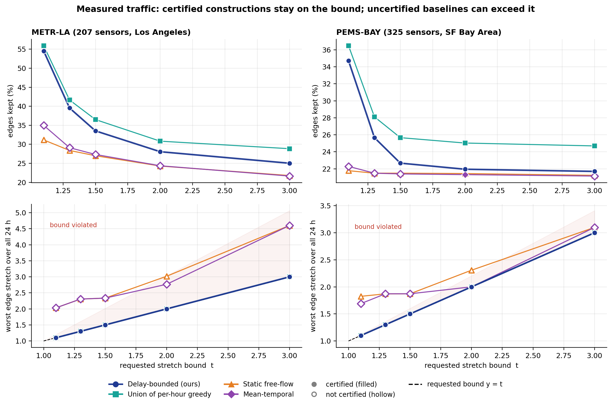
*Fig. 1. METR-LA and PEMS-BAY: edges kept and attained worst-edge stretch. Filled markers are certified; hollow markers violate the bound.*

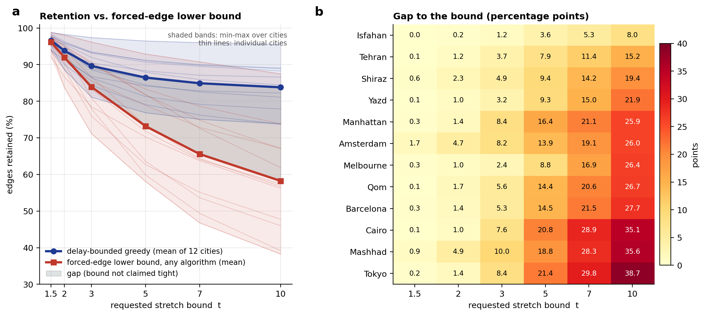
*Fig. 2. Theorem 2 lower bound vs. delay-bounded greedy retention (a) and the gap per city and t (b).*

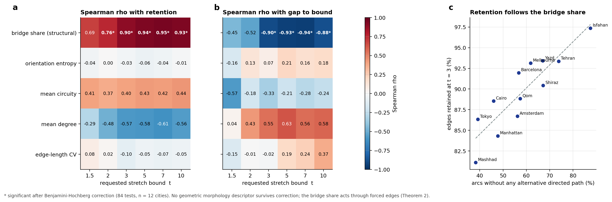
*Fig. 3. Spearman matrices with Benjamini-Hochberg-corrected significance, and retention vs. bridge share.*

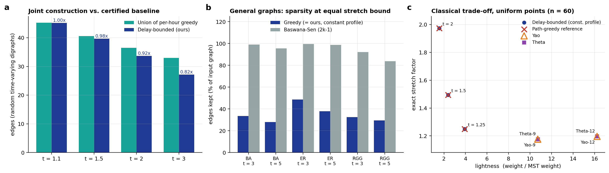
*Fig. 4. Joint construction vs. union of per-hour greedy spanners (a), general graphs vs. Baswana-Sen (b), classical lightness-stretch trade-off (c).*

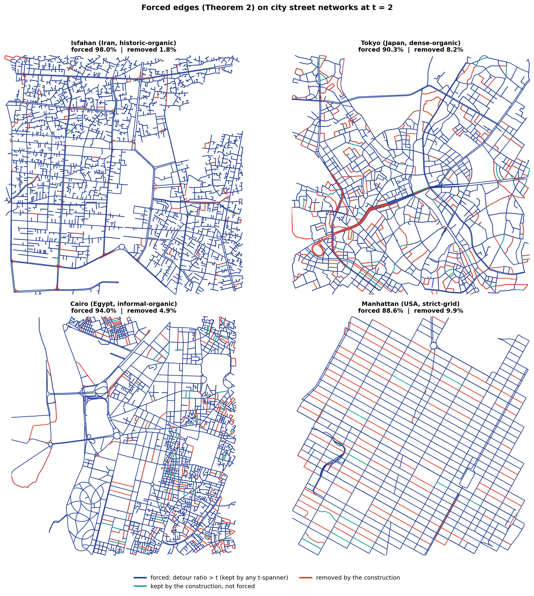
*Fig. 5. Forced edges (Theorem 2, blue), edges kept although not forced (green) and edges removed (red) at t = 2 on four OSM city cores.*

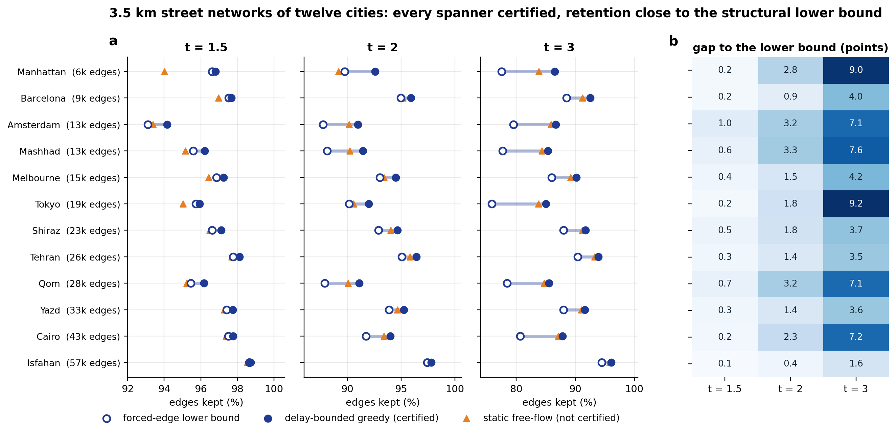
*Fig. 7. 3.5 km street networks of twelve cities: delay-bounded greedy retention against the forced-edge lower bound (a), and the gap in points (b). Every spanner is certified; the orange triangles are the static free-flow baseline, which is not.*

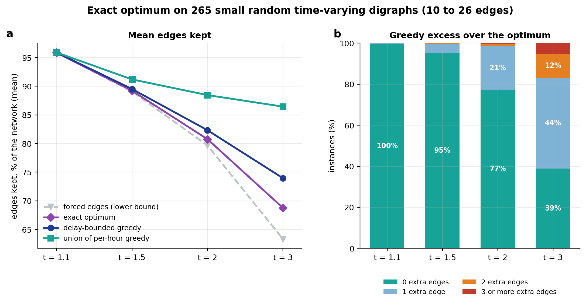
*Fig. 8. Exact optimum on small random time-varying digraphs: mean edges kept by the lower bound, the optimum, the greedy construction and the union baseline (a), and how many edges the greedy construction keeps beyond the optimum (b).*

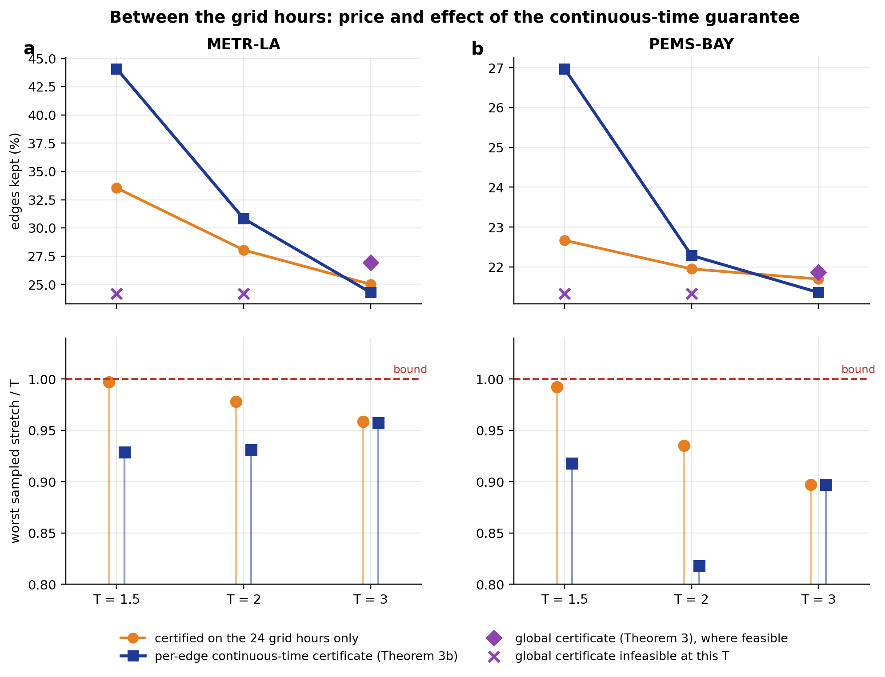
*Fig. 9. Between the grid hours on METR-LA and PEMS-BAY: edges kept by three certificates (top), and the worst sampled stretch relative to the bound (bottom).*

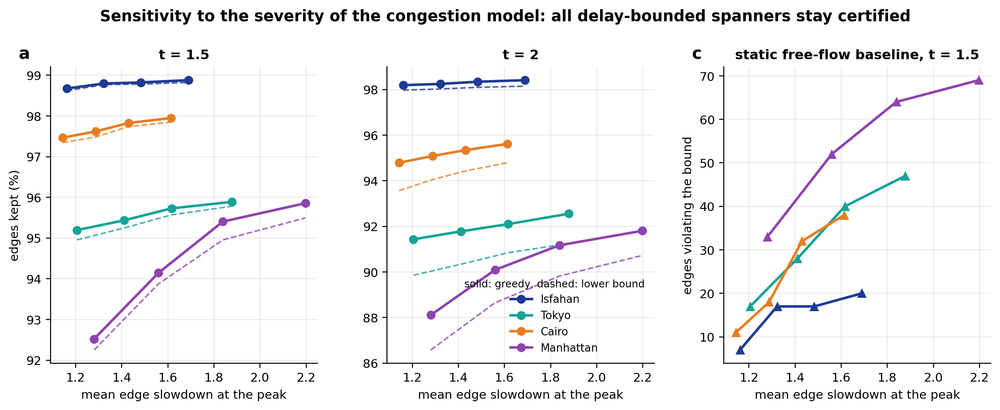
*Fig. 10. Sensitivity to the severity of the congestion model: retention and lower bound at t = 1.5 and t = 2 (a, b), and the static free-flow baseline's violating edges (c).*

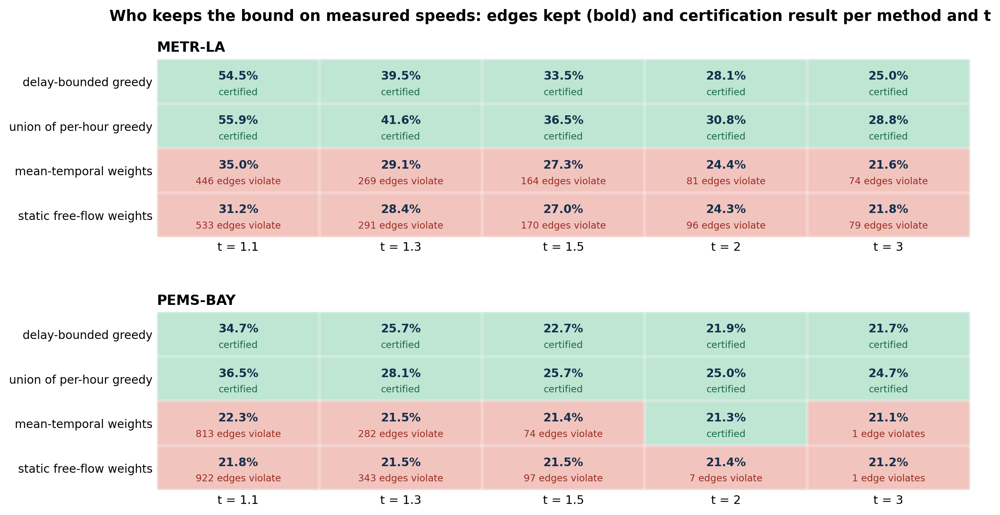
*Fig. 11. Certification matrix on measured speeds: edges kept and certification result of four constructions for each t, on METR-LA and PEMS-BAY.*

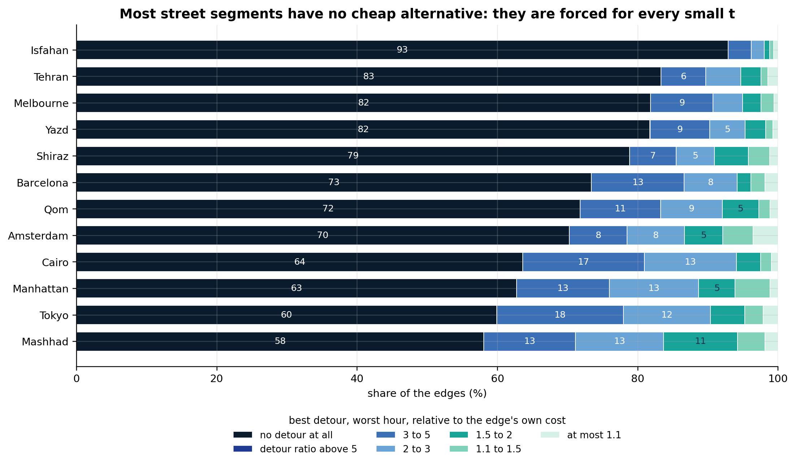
*Fig. 12. Anatomy of the street segments in the twelve cities: how much alternative each segment has, measured by the best detour at the worst hour relative to the segment's own cost.*

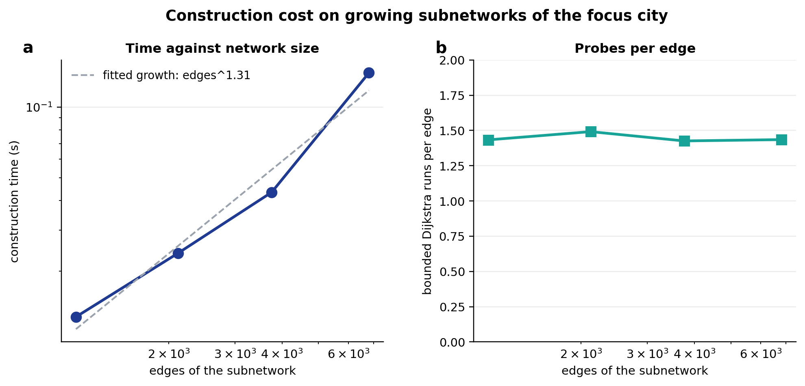
*Fig. 13. Construction time and bounded-Dijkstra runs per edge on four growing subnetworks of the focus city (four points only; no claim about asymptotics is made).*

Vector (PDF) versions of all figures are in `results/figures/`. Regenerate with `python benchmarks/make_figures.py` and `python benchmarks/make_figures_extra.py`; the banner, the pipeline diagram and the animation come from `python benchmarks/make_visuals.py`.

---

## 5f. Continuous-time guarantee (off-grid robustness)

Theorem 1 certifies the 24 grid hours. `benchmarks/offgrid_guarantee.py` implements two provable continuous-time constructions (Theorems 3 and 3b, derivations in the script docstring) based on the piecewise-linear profile `td_cost`. Theorem 3b uses a per-edge interpolation factor rho_e and certifies every time of day. Edges kept (%), measured speeds, sub-grid of 7.5 min:

| Dataset | T | grid-only (Thm 1) | continuous-time (Thm 3b) | edges kept only because rho_e^2 >= T (%) | off-grid violations in sampled checks |
|---|---|---|---|---|---|
| METR-LA | 1.5 | 33.5 | 44.1 | 4.03 | 0 |
| METR-LA | 2.0 | 28.1 | 30.8 | 0.00 | 0 |
| METR-LA | 3.0 | 25.0 | 24.3 | 0.00 | 0 |
| PEMS-BAY | 1.5 | 22.7 | 27.0 | 1.22 | 0 |
| PEMS-BAY | 2.0 | 22.0 | 22.3 | 0.00 | 0 |
| PEMS-BAY | 3.0 | 21.7 | 21.4 | 0.00 | 0 |

The single global factor of Theorem 3 is feasible only at T = 3 on both datasets (rho = 1.176 / 1.173 even on a 3.75-minute sub-grid); the per-edge version removes that restriction. The sampled off-grid checks are empirical sanity checks; the guarantee is the theorem. Raw results: `results/benchmarks/offgrid_guarantee_metrla.csv`, `offgrid_guarantee_pemsbay.csv`.

```bash
python benchmarks/offgrid_guarantee.py --dataset metrla  --speeds METR-LA.csv  --T 1.5 2.0 3.0
python benchmarks/offgrid_guarantee.py --dataset pemsbay --speeds PEMS-BAY.csv --T 1.5 2.0 3.0
```

---

## 5i. Sensitivity to congestion severity

Generated by `scripts/render_severity_section.py` from `results/benchmarks/severity_sensitivity.csv` (`python benchmarks/severity_sensitivity.py`; cities: Cairo, Isfahan, Manhattan, Tokyo). The excess delay of every edge is rescaled, tt_k(h) = tt_ff (1 + k (tt(h)/tt_ff - 1)); k = 1 is the original model. Measured peak/off-peak slowdowns are 1.34-1.38x on freeways and 2.07x on Manhattan streets against 1.50x for the model's representative edge; k = 2.14 reproduces the Manhattan slowdown for that edge.

| Severity factor k | Mean per-edge max/min travel-time ratio | t | Delay-bounded kept (%) | Forced lower bound (%) | Static free-flow kept (%) | Static free-flow uncertified (cities) | Mean violating edges, static free-flow | Delay-bounded certified in all cities |
|---|---|---|---|---|---|---|---|---|
| 0.5 | 1.20 | 1.5 | 96.0 | 95.8 | 95.0 | 4 of 4 | 17 | yes |
| 0.5 | 1.20 | 2 | 93.1 | 92.0 | 92.1 | 4 of 4 | 23 | yes |
| 1 | 1.39 | 1.5 | 96.5 | 96.3 | 95.0 | 4 of 4 | 29 | yes |
| 1 | 1.39 | 2 | 93.8 | 92.8 | 92.1 | 4 of 4 | 37 | yes |
| 1.5 | 1.59 | 1.5 | 96.9 | 96.8 | 95.0 | 4 of 4 | 38 | yes |
| 1.5 | 1.59 | 2 | 94.2 | 93.3 | 92.1 | 4 of 4 | 48 | yes |
| 2.14 | 1.84 | 1.5 | 97.1 | 97.0 | 95.0 | 4 of 4 | 44 | yes |
| 2.14 | 1.84 | 2 | 94.6 | 93.7 | 92.1 | 4 of 4 | 58 | yes |

Means are over the listed cities. The static free-flow baseline does not depend on k (it ignores congestion), so its retention is constant while its violations are measured against the rescaled profile.

---

## 5h. Congestion model vs measured street speeds (NYC)

Generated by `scripts/nyc_multi_borough.py` from the NYC DOT traffic-speed feed (dataset `i4gi-tjb9`, 2026-09-01 to 2026-10-01, weekdays only) and `results/congestion_shape_validation_<borough>.json`. The model's peak/off-peak slowdown for its representative edge is 1.50x.

| Borough | Weekdays | Pearson r (95% CI) | Spearman rho | Measured peak/off-peak slowdown | Slowest / fastest hour |
|---|---|---|---|---|---|
| Manhattan | 20 | 0.69 (0.61 to 0.74) | 0.76 | 2.07x | 17:00 / 5:00 |
| Brooklyn | 20 | 0.84 (0.81 to 0.87) | 0.87 | 1.84x | 17:00 / 4:00 |

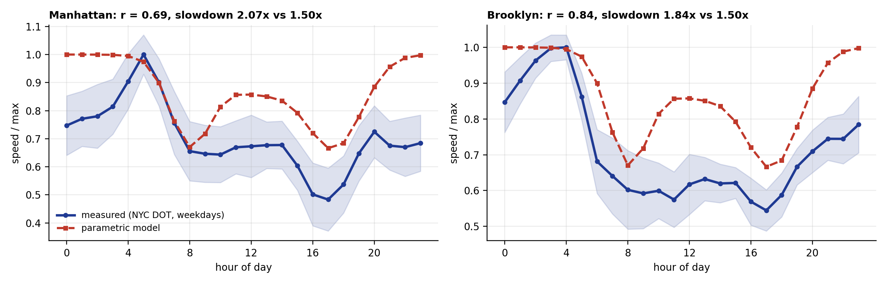

This is a shape comparison for one month; it is not a calibration of congestion severity (see section 5i for sensitivity to severity).

---

## 5j. Gap to the exact optimum on small instances

On road networks the optimum is out of reach, so the quality of the greedy construction is measured where it can be computed exactly: random time-varying digraphs small enough for an exhaustive search over subgraphs. This says nothing about road-network size or structure; it shows how far the construction can be from the best possible subgraph when the answer is known.

<!-- BEGIN:optimality -->
| t | Instances | Exact optimum (edges, mean) | Forced edges (Theorem 2, mean) | Greedy (mean) | Union of per-hour greedy (mean) | Instances where greedy is optimal | Largest greedy excess (edges) |
|---|---|---|---|---|---|---|---|
| 1.1 | 265 | 15.72 | 15.72 | 15.72 | 15.73 | 99.6% | 1 |
| 1.5 | 265 | 14.57 | 14.54 | 14.62 | 14.90 | 95.1% | 2 |
| 2 | 265 | 13.09 | 12.89 | 13.33 | 14.40 | 77.4% | 3 |
| 3 | 265 | 11.02 | 10.06 | 11.87 | 14.02 | 38.9% | 4 |

Random strongly connected time-varying digraphs with 5 to 9 nodes and 10 to 26 edges (mean 16.5); 265 instances per t. The optimum is the fewest edges of any subgraph that satisfies the all-pairs, all-hours bound, found by exhaustive search. Source: `results/benchmarks/optimality_gap_raw.csv` (`python benchmarks/optimality_gap.py`).
<!-- END:optimality -->

The greedy construction is never smaller than the optimum and the optimum is never smaller than the forced-edge bound (both checked on every row). The excess of the greedy construction grows with `t`: it is rare at small `t`, where almost all edges are forced, and common at large `t`, where there is slack to choose among.

---

## 5g. Larger radius (3.5 km)

Generated by `scripts/update_readme_from_results.py` from `results/benchmarks/large_scale_3500m.csv` (`python benchmarks/large_scale_run.py --dist 3500`). Real OpenStreetMap networks only; the delay-bounded spanner is certified in every row.

| City | Nodes | Edges | t | Delay-bounded kept (%) | Forced lower bound (%) | Static free-flow kept (%) | Static free-flow certified | Union of per-hour greedy kept (%) |
|---|---|---|---|---|---|---|---|---|
| Isfahan | 27646 | 57209 | 1.5 | 98.7 | 98.7 | 98.5 | no |  |
| Isfahan | 27646 | 57209 | 2 | 97.8 | 97.4 | 97.6 | no | 97.9 |
| Isfahan | 27646 | 57209 | 3 | 96.1 | 94.5 | 95.9 | no |  |
| Tokyo | 7596 | 18938 | 1.5 | 95.9 | 95.7 | 95.0 | no |  |
| Tokyo | 7596 | 18938 | 2 | 92.0 | 90.2 | 90.6 | no | 92.6 |
| Tokyo | 7596 | 18938 | 3 | 85.0 | 75.9 | 83.8 | no |  |
| Manhattan | 2637 | 5583 | 1.5 | 96.8 | 96.6 | 94.0 | no |  |
| Manhattan | 2637 | 5583 | 2 | 92.6 | 89.8 | 89.2 | no | 93.9 |
| Manhattan | 2637 | 5583 | 3 | 86.5 | 77.5 | 83.8 | no |  |
| Mashhad | 5707 | 13334 | 1.5 | 96.2 | 95.6 | 95.2 | no |  |
| Mashhad | 5707 | 13334 | 2 | 91.5 | 88.1 | 90.2 | no | 93.4 |
| Mashhad | 5707 | 13334 | 3 | 85.4 | 77.7 | 84.4 | no |  |
| Qom | 11999 | 28118 | 1.5 | 96.2 | 95.5 | 95.2 | no |  |
| Qom | 11999 | 28118 | 2 | 91.1 | 87.9 | 90.1 | no | 92.3 |
| Qom | 11999 | 28118 | 3 | 85.6 | 78.5 | 84.8 | no |  |
| Tehran | 13709 | 26241 | 1.5 | 98.1 | 97.8 | 97.7 | no |  |
| Tehran | 13709 | 26241 | 2 | 96.4 | 95.1 | 95.8 | no | 96.9 |
| Tehran | 13709 | 26241 | 3 | 93.9 | 90.4 | 93.3 | no |  |
| Shiraz | 10470 | 22673 | 1.5 | 97.1 | 96.6 | 96.5 | no |  |
| Shiraz | 10470 | 22673 | 2 | 94.7 | 92.9 | 94.0 | no | 95.4 |
| Shiraz | 10470 | 22673 | 3 | 91.7 | 88.0 | 91.2 | no |  |
| Yazd | 14611 | 32883 | 1.5 | 97.7 | 97.4 | 97.3 | no |  |
| Yazd | 14611 | 32883 | 2 | 95.2 | 93.9 | 94.7 | no | 95.8 |
| Yazd | 14611 | 32883 | 3 | 91.6 | 88.0 | 91.1 | no |  |
| Melbourne | 7281 | 15226 | 1.5 | 97.2 | 96.9 | 96.4 | no |  |
| Melbourne | 7281 | 15226 | 2 | 94.5 | 93.0 | 93.4 | no | 95.1 |
| Melbourne | 7281 | 15226 | 3 | 90.2 | 86.0 | 89.2 | no |  |
| Cairo | 17902 | 43107 | 1.5 | 97.8 | 97.5 | 97.4 | no |  |
| Cairo | 17902 | 43107 | 2 | 94.0 | 91.7 | 93.4 | no | 95.0 |
| Cairo | 17902 | 43107 | 3 | 87.8 | 80.7 | 87.1 | no |  |
| Barcelona | 4632 | 8570 | 1.5 | 97.7 | 97.5 | 97.0 | no |  |
| Barcelona | 4632 | 8570 | 2 | 95.9 | 95.0 | 95.2 | no | 96.5 |
| Barcelona | 4632 | 8570 | 3 | 92.5 | 88.5 | 91.2 | no |  |
| Amsterdam | 5977 | 13270 | 1.5 | 94.2 | 93.1 | 93.4 | no |  |
| Amsterdam | 5977 | 13270 | 2 | 91.0 | 87.8 | 90.2 | no | 92.0 |
| Amsterdam | 5977 | 13270 | 3 | 86.7 | 79.6 | 85.9 | no |  |

---

## 5k. Scaling

How the construction behaves as the network grows. Time is measured on thinned Delaunay networks of increasing size and, where OpenStreetMap could be fetched, on real networks of increasing radius; the machine-independent work (bounded-Dijkstra probes and the nodes they settle) is recorded next to it. If the nodes settled per probe stay bounded while the network grows, the construction cannot be worse than linear in the number of edges.

<!-- BEGIN:scaling -->
| Networks | Runs | Edges | Largest run | Time exponent (95% bootstrap interval) | Nodes settled per probe | Probes per edge |
|---|---|---|---|---|---|---|
| synthetic (thinned Delaunay) | 7 | 2,522 to 2,589,656 | 85.4 s at 2,589,656 edges | 1.09 (1.07 to 1.10) | 5.9 to 6.2 | 4.46 to 4.59 |
| real (OpenStreetMap) | 18 | 1,110 to 180,157 | 15.0 s at 180,157 edges | 1.15 (1.05 to 1.27) | 7.3 to 29.8 | 1.41 to 3.66 |

The exponent is the slope of log time on log edges at t = 2; settled nodes and probes are counted by a replica that is checked against the library on every row. Source: `results/benchmarks/scaling_large.csv` (`python benchmarks/scaling_large.py`).
<!-- END:scaling -->

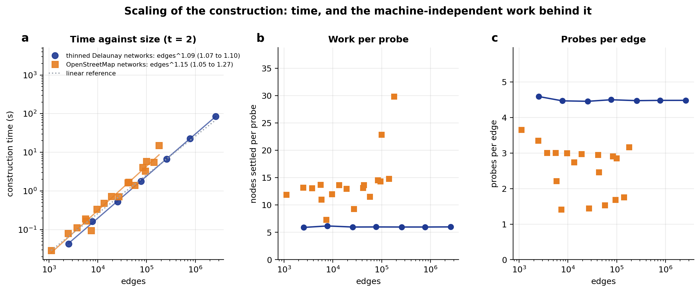
*Fig. 14. Scaling of the construction: time against edges with fitted exponents (a), nodes settled per probe (b) and probes per edge (c).*

---

## 6. Reproduce

```bash
conda create -n spanner_research_env python=3.10 -y
conda activate spanner_research_env
conda install -c conda-forge networkx osmnx geopandas shapely scipy numpy pandas matplotlib seaborn tqdm -y

python -m unittest discover -s tests -v           # unit tests
python run_spanner_benchmark.py                    # full run: focus city + 12-city cross-city study
python verify_results.py                           # independent check of what was just produced
python benchmarks/optimality_gap.py --instances 600 --max-n 9 --max-m 26 --seed 1   # exact optimum on small instances (resumable)
python benchmarks/scaling_large.py --synthetic --sizes 1000 3000 10000 30000 100000 300000 1000000 --t 2   # scaling study (resumable)
python benchmarks/slack_capture.py                                             # share of the removable slack removed (reads existing results)
python benchmarks/forced_by_hour.py --t 1.5 2 3                                # forced edges by hour (section 5m)
python benchmarks/region_fault.py --t 2                                        # region faults, G-F vs H-F (section 5l)
python scripts/update_readme_new_sections.py                                   # write sections 5l and 5m from the result files
python benchmarks/minimality.py --t 1.5 2 3                                    # is the greedy spanner edge-minimal? (section 5n)
python benchmarks/road_exact.py --t 2 3 5                                      # exact optimum on windows of real networks (section 5o)
python benchmarks/emergency_response.py --t 2                                  # response times, intact and after faults (section 5p)
python benchmarks/more_cities.py --t 2 3                                       # more cities, pooled morphology test (section 5q)
python benchmarks/large_scale_run.py --cities Isfahan Tokyo --dist 7000 --t 2 --max-edges 400000   # metropolitan scale (section 5r)
bash scripts/run_parallel_analyses.sh                                          # all of the above in parallel, then refresh the README

python run_spanner_benchmark.py --quick             # fast smoke test (stratified Iran + international)
python run_spanner_benchmark.py --synthetic         # force offline mode everywhere
python run_spanner_benchmark.py --skip-crosscity    # focus city only
python run_spanner_benchmark.py --refresh-cache      # ignore the graph cache and refetch/rebuild
```

If Overpass/OSMnx is unreachable, the pipeline transparently falls back to the deterministic synthetic generator and labels each city's `used_real_osm` flag accordingly — it never silently mixes real and synthetic data without saying so.

---

## 7. Repository layout

```
.
├── run_spanner_benchmark.py       # single self-contained pipeline (model, algorithm, baselines, eval, figures)
├── verify_results.py              # independent verification, separate code path from the pipeline
├── tests/
│   ├── test_certificate.py        # unit tests: positive/negative controls + independent Dijkstra cross-check
│   ├── test_verify_results.py     # negative controls proving the verifier itself catches injected errors
│   └── test_congestion_shape.py   # unit tests + negative controls for the congestion-shape validator
├── tools/
│   ├── make_algorithm_animation.py  # regenerates assets/algorithm_demo.gif from the real algorithm
│   └── validate_congestion_shape.py # shape-only check of the congestion model vs measured NYC DOT speeds (results in section 5h)
├── assets/
│   └── algorithm_demo.gif         # illustrative only — not a benchmark result, feeds no number in this README
├── .github/workflows/ci.yml       # unit tests + smoke run + verification, on every push
├── requirements.txt
├── LICENSE
├── CITATION.cff
├── README.md
└── results/
    ├── spanner_benchmark.png
    ├── spanner_crosscity.png
    ├── spanner_report.json
    ├── benchmark_table.md
    ├── ablation_table.md
    ├── crosscity_table.md
    ├── per_pair_dilation.csv
    └── graph_cache/               # .meta.json tracked; .pkl gitignored (see .gitignore)
```

---

## Claims and evidence

<!-- BEGIN:claims -->
| Claim | Evidence | File |
|---|---|---|
| The construction returns a certified spanner | 36 of 36 spanners certified at 3.5 km (12 cities, 3 values of t); 0 violations on 236 exhaustively checked random instances; delay-bounded certified at every t on METR-LA and PEMS-BAY | `results/benchmarks/large_scale_3500m.csv`, `theorem1_summary.json`, `metrla_table.csv`, `pemsbay_table.csv` |
| Retention is close to a structural lower bound | gap to the forced-edge bound at t = 1.5: at most 1.05 points; at t = 3: 1.6 to 9.2 points | `results/benchmarks/large_scale_3500m.csv`, `docs/THEOREM_FORCED_EDGES.md` |
| Baselines without a certificate break the bound on measured speeds | static free-flow and mean-temporal weights leave 1 to 922 violating edges in the 19 (method, t, dataset) cells where they fail | `results/benchmarks/metrla_table.csv`, `pemsbay_table.csv` |
| The greedy construction is close to the exact optimum on small instances | equal to the optimum in 95% of 265 instances at t = 1.5 and 39% at t = 3; largest excess 4 edges | `results/benchmarks/optimality_gap_raw.csv` |
| The joint construction is smaller than the union of per-hour spanners | **partially supported:** smaller on average (0.82x at t = 3 on random digraphs; 1.4 to 3.8 points of edges on the sensor graphs) but larger in 6 of 236 random instances | `results/benchmarks/theorem1_raw.csv`, `theorem1_edges_vs_union_baseline.csv` |
| The construction scales to large networks | synthetic: time ~ edges^1.09 (95% interval 1.07 to 1.10) from 2,522 to 2,589,656 edges; real: time ~ edges^1.15 (95% interval 1.05 to 1.27) from 1,110 to 180,157 edges; nodes settled per probe range from 5.9 to 29.8; the interval is too wide to decide between near-linear and super-linear growth | `results/benchmarks/scaling_large.csv` |
| Strong sparsification of road networks | **not supported:** 94.2% to 98.7% of the edges are kept at t = 1.5 in the 12 cities | `results/benchmarks/large_scale_3500m.csv` |
<!-- END:claims -->

## Threats to validity

- **Construct:** the congestion model on the street networks is parametric, not fitted to street-level speeds; only its hourly shape is compared with measured speeds, and only on freeway sensor networks and, where available, on street data (section 5h).
- **Internal:** the certificate is exact for the 24 grid hours; between the hours it is guaranteed only by the continuous-time variants of section 5f. Random seeds, origin-destination samples and the exhaustive instances are fixed and listed with the results.
- **External:** twelve cities, one radius for the main tables and one larger radius for three-value sweeps; random digraphs for the exact optimum are small and are not road-like.
- **Statistical:** tests across cities have low power; no result is presented as a general law. The scaling exponent for real networks pools rows from four cities, and its bootstrap interval treats the rows as independent although rows of one city come from the same street network and the larger radii contain the smaller ones; the interval is therefore likely too narrow.

## 8. Known limitations

- The certificate (Theorem 1) holds at the 24 grid hours only. With the piecewise-linear interpolation used by `td_cost`, off-grid times and time-dependent traversal can exceed `t` slightly (observed: at most about 0.5% above `t` in random-instance tests, `benchmarks/offgrid_guarantee.py`). Theorem 3 gives a provable continuous-time bound `t` by certifying on a finer grid at `t / rho^2`, at the price of more retained edges.
- Evaluation scale: the twelve-city table uses city cores of about 1.5 km radius with 30 x 30 OD pairs and 5 repeats per city; larger-radius runs on three cities are reported in section 5g.
- Snapshot (time-slice) model: no departure-time evolution *within* a single traversal; ex-post validated by a FIFO time-dependent Dijkstra experiment (`fifo_violation_rate` in `results/spanner_report.json`).
- Congestion is a parametric model, not measured telemetry — see §5.
- Greedy construction carries no approximation guarantee on `|H|`; the matched-density and Yao-cone baselines are empirical, not theoretical, lower-bound proxies.
- Twelve cities is enough for a directional generalization claim, not a definitive one — see §5.
- Sparsification on road networks is modest (roughly 93-99% of edges retained at t = 1.5 on the OSM cities): most road edges have no short alternative path, so an edge-wise t-spanner cannot remove them.
- On OD-pair dilation (12 cities; 30 sources x 30 targets x 5 repeats per city) the matched-density betweenness control has a larger worst-OD dilation than the construction in 11 of 12 cities (advantage ratio above 1); the ratio is below 1 in Melbourne (0.88); the city-level test in the report gives p = 0.001221 (`results/crosscity_table.md`). The guarantee is the certificate; this comparison is secondary and depends on the choice of the matched control.
- The union of per-hour static greedy spanners is also certified; the advantage of the joint construction over it is small (see §5b).

---

## 9. Related Work

**Classical spanners.** The greedy construction and its size bounds are due to Althöfer, Das, Dobkin, Joseph and Soares [6]; Peleg and Schäffer [7] studied graph spanners in general; the geometric theory is surveyed in the monograph of Narasimhan and Smid [8]; and Yao graphs [9] are the cone-based sparsifier that one of our baselines adapts to road networks. These works treat static edge weights.

**Fault-tolerant geometric spanners.** Abam, de Berg, Farshi and Gudmundsson study spanners that keep their stretch guarantee after all vertices inside a geometric region fail, and they also treat a geodesic variant in which the faulty set is a disk [1]. Our setting differs: no vertices fail, but edge costs change with the hour of day. The two share the idea that one sparse subgraph must certify a stretch bound under a family of scenarios (failure regions there, hours τ ∈ {0..23} here). The first algorithms for geometric fault-tolerant spanners are due to Levcopoulos, Narasimhan and Smid [10].

**Experimental evaluation of spanner algorithms.** Farshi and Gudmundsson compare geometric t-spanner constructions empirically, in terms of quality and running time [2, 3]. We follow this empirical tradition, but on real road networks with time-dependent travel cost rather than Euclidean point sets.

**Improving stretch by augmentation.** Farshi, Giannopoulos and Gudmundsson study how adding edges to a geometric network reduces its stretch factor [4]; our certificate is a sparsification-side counterpart, deciding which edges can be dropped without breaking the bound.

**Weighted point sets.** Abam et al. construct spanners for point sets with weights [5], whereas we place the weights on the edges and let them vary over time.

A longer, source-by-source positioning (what was found, what is unchecked) is in [docs/RELATED_WORK.md](docs/RELATED_WORK.md).

**Optimality of the greedy spanner.** Filtser and Solomon prove that the greedy spanner is existentially optimal, and that the only t-spanner of a greedy t-spanner is the spanner itself [15]; Le and Solomon give truly optimal Euclidean spanners [16]. Existential optimality is a worst-case statement over a graph family and does not bound the greedy size on a given instance; for Euclidean point sets, instance-optimality of the greedy spanner fails [17]. The forced-edge bound and the small exact-optimum study of section 5j are instance-level evidence of a different kind, and no instance-optimality claim is made for road networks.

**Temporal spanners.** Spanners of temporal graphs, whose edges carry time labels and whose paths are time-respecting journeys, are studied by Casteigts, Peters and Schoeters [18]. The model here differs: the graph is fixed, edge costs vary with the hour, and the guarantee is per hourly snapshot (with the continuous-time variants of section 5f).

**Time-dependent routing.** Cooke and Halsey [11] and Orda and Rom [12] established shortest-path computation when edge costs depend on time, including the FIFO property that we check empirically (`fifo_violation_rate`). Geisberger et al. [13] give contraction hierarchies, a leading speed-up for static road graphs; hierarchical road classes appear here only as a baseline.

**Data.** Road networks are obtained with OSMnx [14] from OpenStreetMap.

**References**

1. M. A. Abam, M. de Berg, M. Farshi, J. Gudmundsson. Region-fault tolerant geometric spanners. *Discrete & Computational Geometry* 41(4):556–582, 2009. doi:10.1007/s00454-009-9137-7
2. M. Farshi, J. Gudmundsson. Experimental study of geometric t-spanners. *ACM Journal of Experimental Algorithmics* 14, Article 1.3, 2010 (conference version: ESA 2005, pp. 556–567).
3. M. Farshi, J. Gudmundsson. Experimental study of geometric t-spanners: a running time comparison. WEA 2007, pp. 270–284.
4. M. Farshi, P. Giannopoulos, J. Gudmundsson. Improving the stretch factor of a geometric network by edge augmentation. *SIAM Journal on Computing* 38(1):226–240, 2008.
5. M. A. Abam, M. de Berg, M. Farshi, J. Gudmundsson, M. Smid. Geometric spanners for weighted point sets. *Algorithmica* 61(1):207–225, 2011.
6. I. Althöfer, G. Das, D. Dobkin, D. Joseph, J. Soares. On sparse spanners of weighted graphs. *Discrete & Computational Geometry* 9(1):81–100, 1993. doi:10.1007/BF02189308
7. D. Peleg, A. A. Schäffer. Graph spanners. *Journal of Graph Theory* 13(1):99–116, 1989. doi:10.1002/jgt.3190130114
8. G. Narasimhan, M. Smid. *Geometric Spanner Networks*. Cambridge University Press, 2007.
9. A. C.-C. Yao. On constructing minimum spanning trees in k-dimensional spaces and related problems. *SIAM Journal on Computing* 11(4):721–736, 1982. doi:10.1137/0211059
10. C. Levcopoulos, G. Narasimhan, M. Smid. Efficient algorithms for constructing fault-tolerant geometric spanners. *Proc. 30th ACM Symposium on Theory of Computing (STOC)*, pp. 186–195, 1998. doi:10.1145/276698.276734
11. K. L. Cooke, E. Halsey. The shortest route through a network with time-dependent internodal transit times. *Journal of Mathematical Analysis and Applications* 14(3):493–498, 1966. doi:10.1016/0022-247X(66)90009-6
12. A. Orda, R. Rom. Shortest-path and minimum-delay algorithms in networks with time-dependent edge-length. *Journal of the ACM* 37(3):607–625, 1990. doi:10.1145/79147.214078
13. R. Geisberger, P. Sanders, D. Schultes, C. Vetter. Exact routing in large road networks using contraction hierarchies. *Transportation Science* 46(3):388–404, 2012. doi:10.1287/trsc.1110.0401
14. G. Boeing. OSMnx: New methods for acquiring, constructing, analyzing, and visualizing complex street networks. *Computers, Environment and Urban Systems* 65:126–139, 2017. doi:10.1016/j.compenvurbsys.2017.05.004

15. A. Filtser, S. Solomon. The greedy spanner is existentially optimal. arXiv:1605.06852 (preliminary version: PODC 2016).
16. H. Le, S. Solomon. Truly optimal Euclidean spanners. FOCS 2019.
17. H. Le, S. Solomon, C. Than, C. D. Tóth, T. Zhang. Towards instance-optimal Euclidean spanners. arXiv preprint.
18. A. Casteigts, J. G. Peters, J. Schoeters. Temporal cliques admit sparse spanners. *ICALP 2019* (LIPIcs 134); journal version doi:10.1016/j.jcss.2021.04.004.

## Data and attribution

Street-network data: (c) OpenStreetMap contributors, available under the Open Database Licence (ODbL, https://www.openstreetmap.org/copyright). Derived graphs cached in `results/graph_cache/` are derivative databases under the same licence. Traffic speeds: METR-LA and PEMS-BAY as distributed by Li et al. (ICLR 2018; https://zenodo.org/records/5724362), sensor graphs from `liyaguang/DCRNN`. The graph snapshots behind the reported numbers should be archived with a persistent identifier (for example a Zenodo DOI) for long-term reference.

---

## 10. Citation

See [`CITATION.cff`](CITATION.cff), or:

```bibtex
@software{delay_bounded_spanner_2026,
  title  = {Delay-Bounded Time-Varying Geometric t-Spanners for Urban Road Networks},
  author = {Fallahzadeh, Soheil},
  year   = {2026},
  license = {MIT},
  note   = {Certified temporal sparsification, validated on real OpenStreetMap road networks and on measured sensor speeds}
}
```
